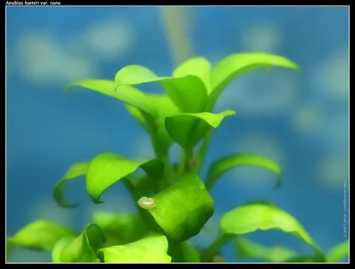
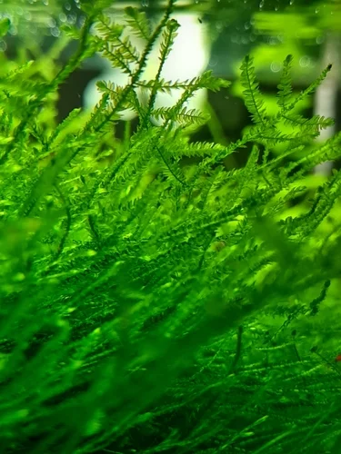
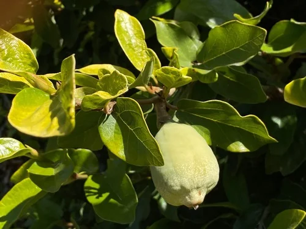
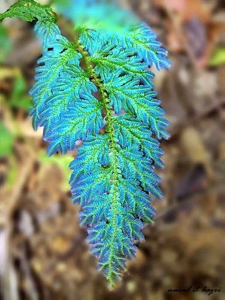
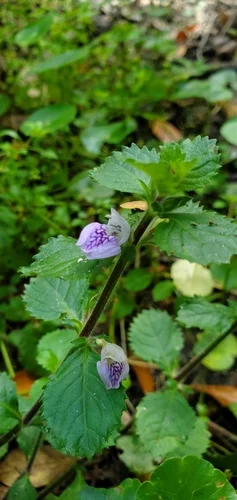

## ESTRUCTURA DE FICHA DE PLANTA

```
### Nombre Común (Nombre científico)
**Familia**:
**Origen**:
**Tamaño**: altura máxima en acuario
**Temperatura**: °C
**pH**:
**GH**: °dGH
**Dificultad**: ★ a ★★★★★
**Luz**: muy baja / baja / media / alta / muy alta
**CO2**: no necesario / recomendable / imprescindible
**Fertilización**: baja / media / alta
**Crecimiento**: muy lento / lento / medio / rápido / muy rápido
**Posición**: primer plano / plano medio / trasera / flotante / fijada en roca o madera
**Sustrato**: inerte / nutritivo recomendado / nutritivo imprescindible
**Propagación**: esquejes / estolones / rizoma / esporas
```

---

## Plantas — Paludario

> El paludario es el hábitat ideal para plantas anfibias: especies que crecen tanto sumergidas como emergidas. Las plantas emergidas suelen crecer más rápido y florecer. Se combinan plantas acuáticas para la zona de agua con plantas tropicales para la zona terrestre húmeda.

---

### Anubias (Anubias barteri var. nana)


**Familia**: Araceae
**Origen**: Camerún, Nigeria
**Tamaño**: 5 – 15 cm sumergida; hasta 30 cm emergida
**Temperatura**: 20 – 30°C
**pH**: 5.5 – 9.0
**GH**: 0 – 20 °dGH
**Dificultad**: ★☆☆☆☆
**Luz**: muy baja – media
**CO2**: no necesario
**Fertilización**: baja
**Crecimiento**: muy lento sumergida; algo más rápida emergida
**Posición**: zona de agua fijada en roca o madera; también en zona de orilla
**Sustrato**: NO enterrar el rizoma
**Propagación**: división del rizoma
**Notas**: Planta anfibia ideal. En forma emergida suele florecer (inflorescencia blanca tipo espátula). Muy resistente en la transición agua-tierra. Las raíces sumergidas sirven de refugio a peces y gambas.

---

### Musgo de Java (Taxiphyllum barbieri)


**Familia**: Hypnaceae
**Origen**: Asia del Sur y Sudeste Asiático
**Tamaño**: tapiz de 2 – 8 cm
**Temperatura**: 15 – 30°C
**pH**: 5.0 – 9.0
**GH**: 0 – 20 °dGH
**Dificultad**: ★☆☆☆☆
**Luz**: muy baja – alta
**CO2**: no necesario
**Fertilización**: baja
**Crecimiento**: lento – medio
**Posición**: zona acuática en roca o madera; también en zona húmeda emergida
**Sustrato**: no aplica
**Propagación**: división
**Notas**: Crece tanto sumergido como en zona de orilla húmeda. En forma emergida forma tapices más densos y oscuros. En la zona terrestre húmeda del paludario se extiende sobre rocas y madera creando un efecto musgo muy natural.

---

### Ficus Trepador / Ficus pumila


**Familia**: Moraceae
**Origen**: Asia Oriental (China, Japón, Vietnam)
**Tamaño**: trepadora; cubre superficies ilimitadamente
**Temperatura**: 18 – 30°C
**pH**: no aplica (terrestre)
**GH**: no aplica
**Dificultad**: ★☆☆☆☆
**Luz**: media – alta
**CO2**: no aplica
**Fertilización**: baja
**Crecimiento**: rápido
**Posición**: zona terrestre; trepa paredes del paludario
**Sustrato**: tierra o sustrato húmedo
**Propagación**: esquejes
**Notas**: La planta trepadora más popular para la zona terrestre del paludario. Se adhiere a cualquier superficie con raíces adhesivas. Cubre rápidamente el fondo falso y las paredes traseras de madera/corcho creando la textura de selva. Necesita humedad alta en la zona terrestre.

---

### Helechos Tropicales (Selaginella spp. / Adiantum spp.)


**Familia**: Selaginellaceae / Pteridaceae
**Origen**: Trópicos (distribución amplia)
**Tamaño**: 10 – 40 cm según especie
**Temperatura**: 20 – 28°C
**pH**: no aplica (terrestre húmedo)
**GH**: no aplica
**Dificultad**: ★★☆☆☆
**Luz**: baja – media (sin luz directa)
**CO2**: no aplica
**Fertilización**: baja
**Crecimiento**: medio
**Posición**: zona terrestre húmeda
**Sustrato**: tierra húmeda, musgo vivo, sustrato coco
**Propagación**: división; esporas
**Notas**: Los helechos tropicales necesitan alta humedad (>70%) que el paludario proporciona naturalmente. Selaginella es más tolerante; Adiantum más delicado pero muy ornamental. Perfectos para crear el aspecto de sotobosque tropical en la zona terrestre.

---

### Hygrophila Difformis (Water Wisteria)


**Familia**: Acanthaceae
**Origen**: India, Bangladés
**Tamaño**: 30 – 50 cm sumergida; 60+ cm emergida
**Temperatura**: 22 – 30°C
**pH**: 6.0 – 8.0
**GH**: 2 – 15 °dGH
**Dificultad**: ★☆☆☆☆
**Luz**: media – alta
**CO2**: no necesario
**Fertilización**: media
**Crecimiento**: rápido
**Posición**: zona de agua trasera; también zona de orilla emergida
**Sustrato**: inerte
**Propagación**: esquejes
**Notas**: Planta anfibia por excelencia. La forma sumergida tiene hojas muy recortadas (como helecho); la forma emergida tiene hojas simples más grandes. En paludarios la transición sumergida-emergida produce la variación morfológica que hace esta planta fascinante. Crece muy rápido.
