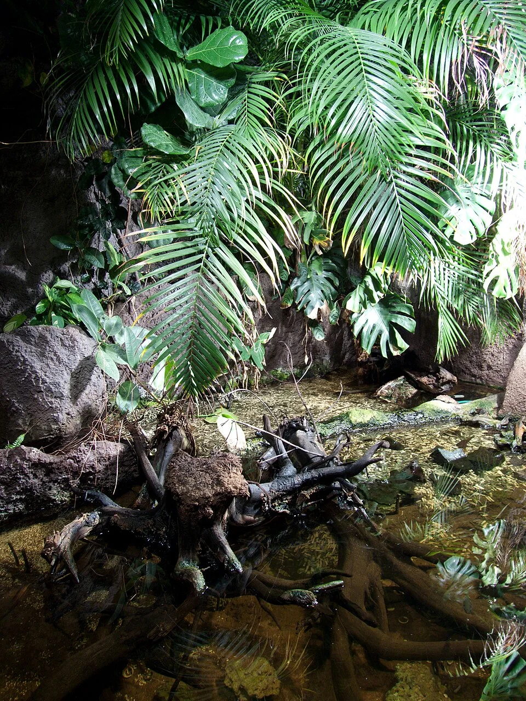

# PALUDARIO

**Dificultad general**: ★★★★☆
**Coste de setup**: alto
**Tamaño mínimo recomendado**: 60 L
**Para quién es**: avanzado (combina conocimientos de acuariofilia y terrariofilia)

---

## Descripción

Mitad acuario, mitad terrario. La parte emergida puede albergar plantas tropicales, musgos, helechos, bromeliáceas y fauna terrestre o semiacuática: ranas, salamandras, cangrejos semiterrestres, geckos. El resultado visual es de extraordinaria belleza.

---

## Tipos de paludario

| Tipo | Proporción agua/tierra | Fauna típica |
|------|----------------------|-------------|
| Acuático dominante | 70% agua / 30% tierra | Peces tropicales + plantas emergidas |
| Equilibrado | 50% agua / 50% tierra | Anfibios, cangrejos, peces pequeños |
| Terrestre dominante | 30% agua / 70% tierra | Ranas, geckos semiacuáticos |
| Ripario | Corriente que simula río | Peces de corriente, bromeliáceas |

---

## Parámetros del agua (zona acuática)

| Parámetro | Rango |
|-----------|-------|
| Temperatura | 22 – 28°C (según fauna) |
| pH | 6.5 – 7.5 |
| GH | 5 – 15 °dGH |
| NH3 | 0 ppm |
| NO2 | 0 ppm |
| NO3 | < 30 ppm |

---

## Equipamiento necesario

| Equipo | Especificaciones |
|--------|-----------------|
| Filtro | Externo o sumergible (debe ser silencioso) |
| Iluminación | LED de espectro completo para plantas emergidas (T5 o LED hortícola) |
| Calefactor | Si la fauna acuática lo requiere |
| Humidificador / Nebulizador | Para mantener humedad alta en la zona terrestre |
| Ventilación | Rejilla en la tapa para evitar acumulación de gases y moho |
| Sustrato terrestre | Mezcla de tierra de selva + perlita + musgo de turbera + grava |
| Sustrato acuático | Arena fina o grava según fauna |

---

## Fauna para paludario

**Anfibios:**
- Dendrobatidae (ranas de punta de flecha): colores increíbles; de tierra, necesitan humedad
- Ranas de cristal (*Centrolenidae*): transparentes, nocturnas; viven en las plantas
- Ranita de San Antonio (*Hyla arborea*): muy activa, sale del agua
- Salamandra de fuego (*Salamandra salamandra*): semiacuática; agua fría

**Invertebrados:**
- Cangrejo vampiro (*Geosesarma*): imprescindible la zona terrestre
- Isópodos y colémbolos: micro-cleanup crew para la parte terrestre
- Gusanos de tierra: descomponedores del suelo

---

## Zona acuática del paludario

Los peces en paludario deben ser capaces de vivir en las condiciones del sistema (temperatura determinada por las plantas terrestres, humedad alta). Peces enanos de biotopo (Boraras, Danio margaritatus, gambas Cherry) son los más indicados.

---

## Zona terrestre del paludario

- **Sustrato terrestre**: mezcla de tierra de selva + perlita + musgo de turbera + capa de sustrato de grava
- **Isópodos**: esenciales para descomponer los excrementos de la fauna terrestre y mantener la zona terrestre sin moho
- **Colémbolos**: descomponen micro materia orgánica
- **Plantas terrestres**: Bromeliáceas, helechos, musgos, orquídeas miniatura, Ficus pumila, Peperomia

---

## Algas comunes — cuáles son, por qué aparecen, cómo eliminarlas

### Alga Parda y GHA
Comportamiento igual que en acuarios estándar en la zona acuática.

---

### Moho (zona terrestre)
No es alga, pero es el problema análogo en la zona terrestre. El moho (hongos blancos) aparece en la tierra y madera cuando la humedad es muy alta y la ventilación es baja.
**Solución:** Mejorar la ventilación (rejilla en la tapa). Los isópodos y colémbolos comen el moho activamente. Retirar madera muerta o alimento sobrante.

---

## Errores más comunes

- Construir el paludario sin sistema de drenaje o con filtración insuficiente
- No añadir isópodos y colémbolos (el moho se convierte en un problema serio)
- Elegir fauna terrestre incompatible con la temperatura o humedad del sistema
- No prever el crecimiento de las plantas emergidas (pueden bloquearlo todo)
- Poca ventilación → condensación excesiva → moho masivo

---

## Consejos clave

- Los isópodos (Porcellio, Armadillidium) y colémbolos son el "filtro biológico" de la parte terrestre: imprescindibles
- La parte terrestre debe tener acceso de agua pero con drenaje para evitar encharcamiento excesivo
- Las bromeliáceas son perfectas para paludario: acumulan agua en sus rosetas (fitoremas) donde viven ranas
- Un paludario bien diseñado apenas necesita mantenimiento si los "janitors" (isópodos + colémbolos) están bien establecidos
- Fotografiar el desarrollo semanal: los paludarios mejoran visiblemente con el tiempo a medida que las plantas crecen
