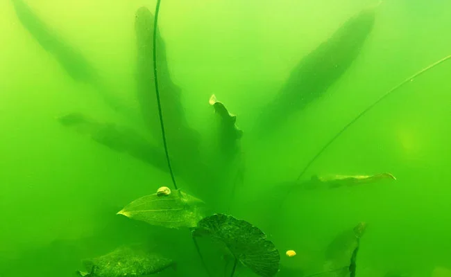

## Agua Verde (Green Water / Bloom de Fitoplancton)

**Nombre científico**: *Euglena viridis*, *Chlorella* sp., *Chlamydomonas* sp.
**Tipo taxonómico**: Euglenofitas y Clorofitas unicelulares en suspensión
**Agua**: Dulce principalmente (raro en marino)
**Color**: Verde intenso, verde-amarillento, agua opaca
**Textura**: El agua es opaca, no se pueden ver los peces a 5 cm de distancia en casos graves

**Aspecto**: El agua se vuelve completamente verde opaca. No hay algas visibles en cristal ni decoración — el color está en el agua misma por millones de microalgas en suspensión. Puede desarrollarse en 24-48 horas si las condiciones son perfectas.

**¿Dónde aparece?**: El agua completa del acuario.

**¿Es peligrosa?**:
- No directamente para los peces
- Reduce visibilidad
- Consume O₂ nocturno en grandes cantidades — puede causar hipoxia nocturna y muertes
- En grandes proliferaciones con luz solar directa puede ser peligrosa

**Parámetros relacionados**:
- **Luz solar directa**: La causa más común
- **NH₃/NH₄⁺**: Elevado (acuario nuevo, sobrecarga)
- **NO₃**: > 50 ppm
- **PO₄**: Elevado
- **Temperatura alta**: Verano, acuarios sin control

**Causas principales**:
1. **Luz solar directa** sobre el acuario — la más frecuente
2. Nutrientes muy elevados (NH₃, NO₃, PO₄)
3. Acuario nuevo sin bacterias que consuman los nutrientes
4. Temperatura alta combinada con mucha luz
5. Ausencia de plantas que compitan

**Cómo eliminarla**:

- **UV Sterilizer (esterilizador UV)**: El método más efectivo y rápido. Un esterilizador UV de 5-9W conectado al circuito de filtrado mata las microalgas en 2-4 días. Luego hacer cambio de agua.
- **Oscuridad total**: 3-5 días sin ninguna luz. Muy efectivo. Las plantas resistirán, los peces no sufren.
- **Floculante**: Algunos productos (Seachem Clarity, JBL Clearol) floculan las microalgas para que las capture el filtro. El filtro debe tener lana/algodón fino.
- **Cambios de agua masivos**: Reducir nutrientes drásticamente. 50% de cambio diario durante 3-5 días.
- **Apartar de la luz solar**: Mover el acuario o tapar la ventana.
- **Biológico**: Dafnias (*Daphnia magna*) — se comen las microalgas con gran eficiencia. Introducir un cultivo de dafnias durante 1 semana.

**Prevención**: Nunca exponer el acuario a luz solar directa, mantener nutrientes en rango, plantas competidoras de rápido crecimiento.

---