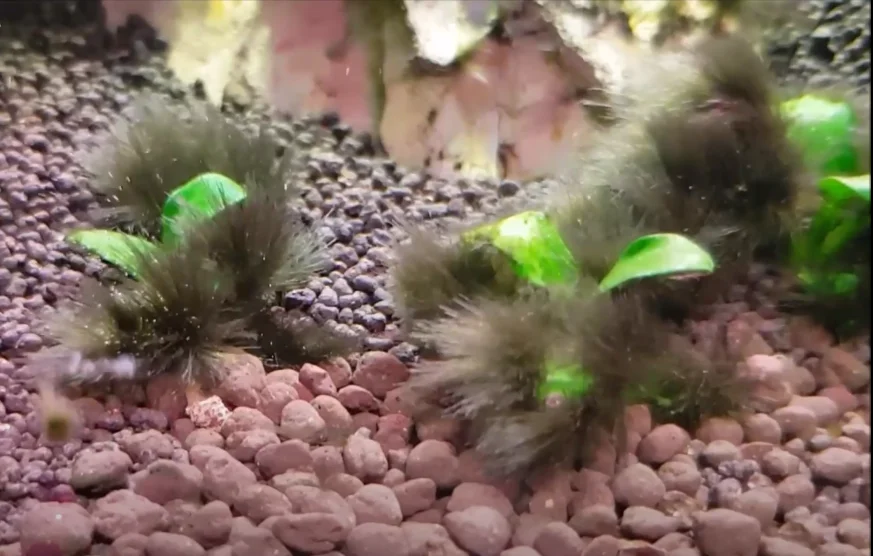
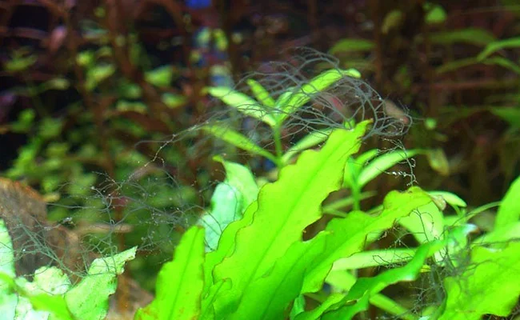
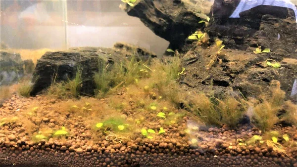
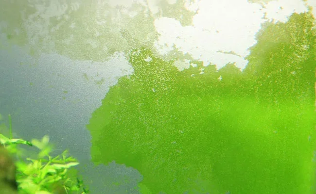
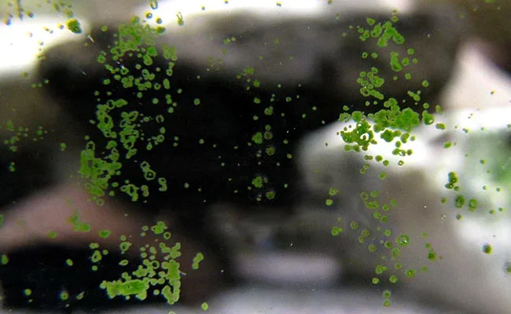
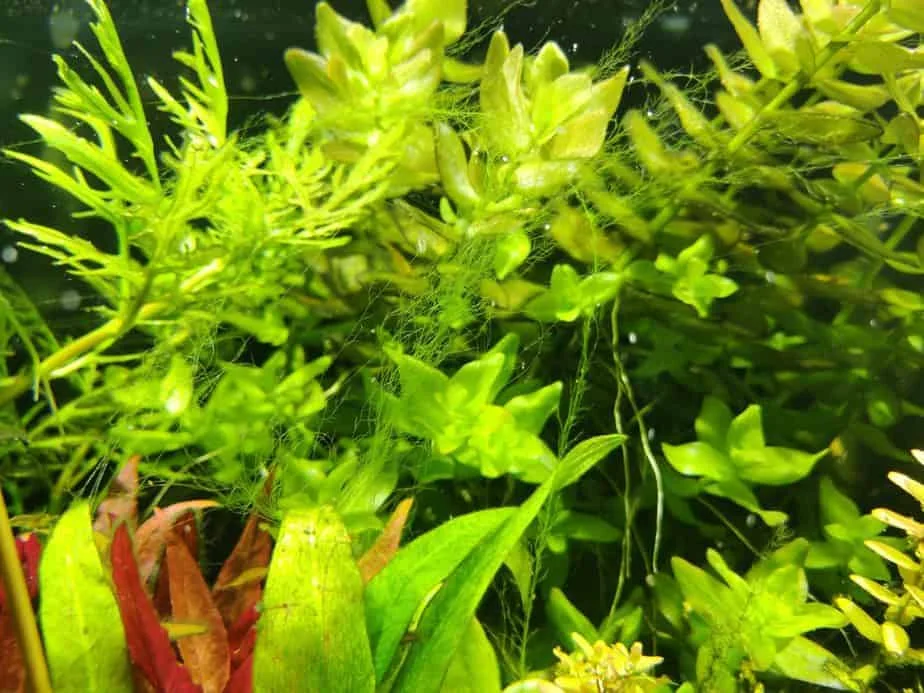
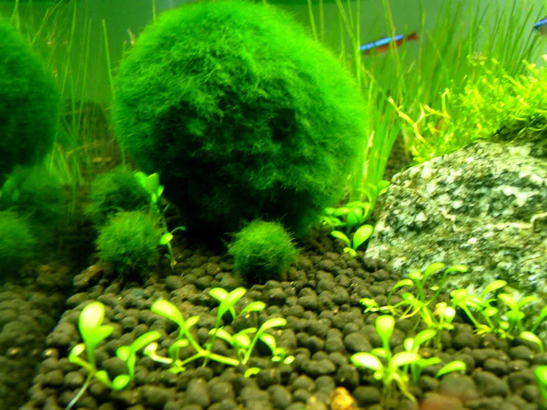

# Algas de Agua Dulce

---

## Especies e Identificación

### Alga Barba Negra (BBA)

[Ficha completa](BBA/BBA.md)

### Alga Staghorn

[Ficha completa](Staghorn/Staghorn.md)

### Diatomeas

[Ficha completa](Diatomeas/Diatomeas.md)

### GDA — Alga Verde en Polvo

[Ficha completa](GDA/GDA.md)

### GSA — Alga Mancha Verde

[Ficha completa](GSA/GSA.md)

### GHA — Alga Pelo Verde

[Ficha completa](GHA/GHA.md)

### Cladophora

[Ficha completa](Cladophora/Cladophora.md)

### Cianobacterias

[Ficha completa](Cianobacterias/Cianobacterias.md)

### Agua Verde

[Ficha completa](Agua verde/Agua_verde.md)
