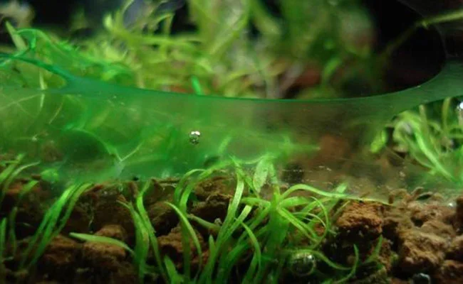

## Cianobacterias (Alga Azul-Verde / Ciano)

**Nombre científico**: *Oscillatoria* sp., *Phormidium* sp., *Lyngbya* sp., *Anabaena* sp.
**Tipo taxonómico**: Bacteria fotosintética (Cyanobacteria) — NO es un alga real
**Agua**: Dulce y marina
**Color**: Verde oscuro, azul-verde, a veces rojizo, marrón o negro
**Textura**: Membrana gelatinosa, resbaladiza, forma capas o "mantas"

**Aspecto**: Capa gelatinosa, resbaladiza, que cubre el sustrato y decoración como una película. Puede desprenderse en hojas enteras. Olor característico muy penetrante (a tierra mojada, a barro, incluso a ajo). En casos graves cubre todo el fondo como una alfombra azul-verde.

**¿Dónde aparece?**: Sustrato (especialmente zonas de poca corriente), decoración, plantas del fondo. En marino: sobre la roca viva y sustrato.

**¿Es peligrosa?**:
- Algunos géneros producen **toxinas (cianotoxinas)**: hepatotoxinas (*Microcystis*) y neurotoxinas (*Anabaena*). En acuarios domésticos raramente alcanzan concentraciones letales, pero en grandes proliferaciones pueden afectar a peces y camarones sensibles.
- Consume O₂ nocturno en grandes cantidades.
- Libera sustancias alelopáticas que inhiben el crecimiento de plantas.

**Parámetros relacionados**:
- **Nitratos bajos con fosfatos relativamente altos**: La ciano puede **fijar nitrógeno atmosférico** (*Anabaena*, *Nostoc*), por lo que prolifera cuando hay poco NO₃ disponible
- **Flujo de agua escaso**: Zonas sin circulación son el hábitat ideal
- **Sustrato profundo y anóxico**: La ciano ama los sustratos ricos en materia orgánica
- **pH alto**: pH > 7,5 favorece algunos géneros
- **Luz**: Puede proliferar con poca o mucha luz

**Causas principales**:
1. Flujo de agua insuficiente (especialmente en el fondo)
2. Exceso de materia orgánica en el sustrato (sobrecarga)
3. Desequilibrio N:P (pocos nitratos relativos a fosfatos)
4. Sustratos anóxicos (capa muy gruesa de arena)
5. Acuario nuevo inmaduro
6. Tratamiento previo con antibióticos que destruyó las bacterias nitrificantes

**Cómo eliminarla**:

- **Manual**: Aspirar con sifón durante cambios de agua. Repetir varios días.
- **Biológico**: Pocos animales comen cianobacterias voluntariamente. Algunos caracoles de barro (*Melanoides*) excavadores remueven el sustrato impidiéndola. Los caracoles "trompeta malaya" son útiles.
- **Oscuridad total**: 3-5 días de oscuridad completa reduce drásticamente. Cubrir acuario completamente.
- **Mejorar circulación**: Añadir una bomba de circulación apuntando al fondo.
- **Ajuste N:P**: Elevar nitratos (fertilizantes de NO₃) sin elevar fosfatos.
- **Químico (antibióticos)**:
  - **Eritromicina** (0,2 mg/L): Muy efectiva. Pero destruye las bacterias nitrificantes — monitorear NH₃ y NH₄⁺ después del tratamiento. Retirar animales sensibles. No usar con invertebrados.
  - **Claritromicina o Azitromicina**: Alternativas más suaves.
  - **Método manual+oscuridad**: Preferido para evitar daños al ciclo del nitrógeno.
- **Peróxido de hidrógeno**: Puede usarse en dosis de 1-2 mL/100L con precaución.

**Prevención**: Buena circulación en todo el acuario (sin zonas muertas), evitar sustratos demasiado profundos (> 5 cm), cambios de agua regulares, no acumular detritus.

---