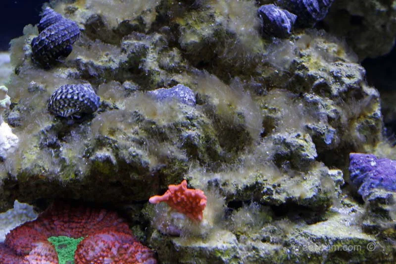
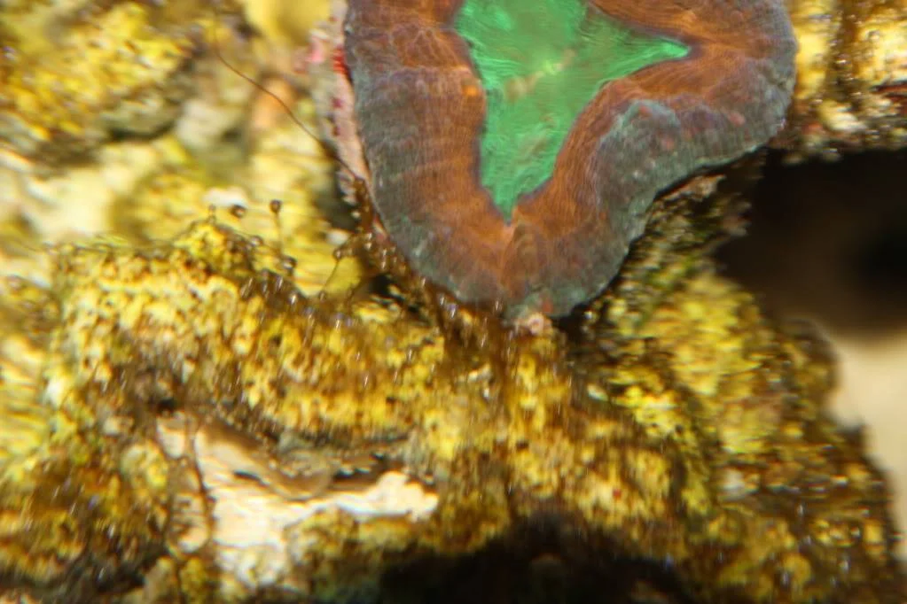
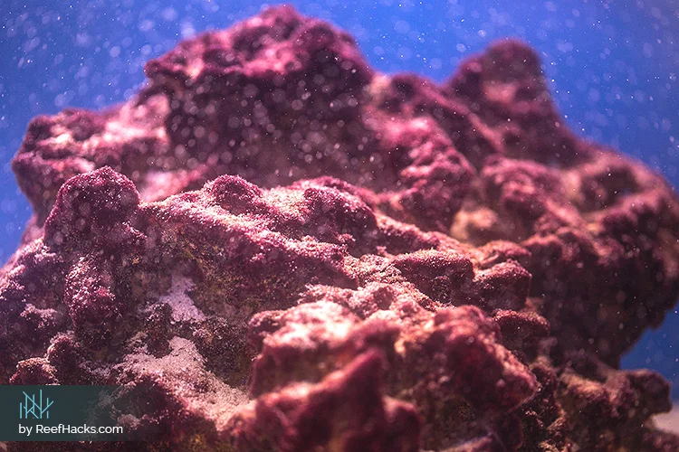
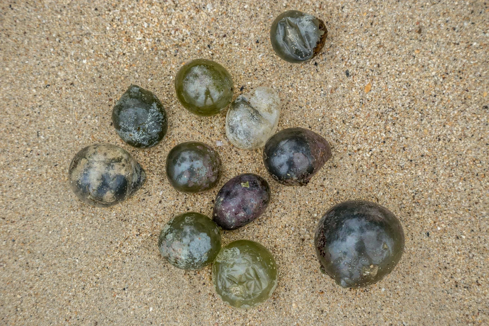
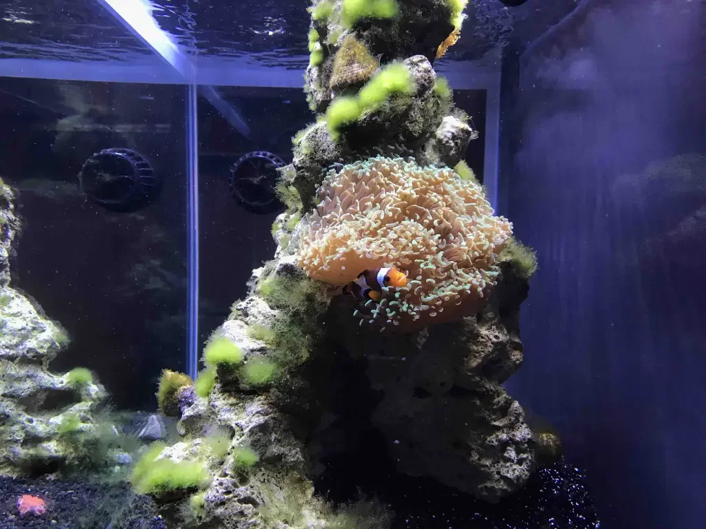
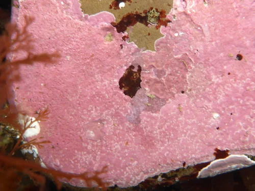

# Algas de Agua Marina

---

## Especies e Identificación

### Diatomeas Marinas

[Ficha completa](Diatomeas marinas/Diatomeas_marinas.md)

### Dinoflagelados

[Ficha completa](Dinoflagelados/Dinoflagelados.md)

### Cianobacterias Marinas

[Ficha completa](Cianobacterias marinas/Cianobacterias_marinas.md)

### Bryopsis

[Ficha completa](Bryopsis/Bryopsis.md)

### Valonia

[Ficha completa](Valonia/Valonia.md)

### Caulerpa

[Ficha completa](Caulerpa/Caulerpa.md)

### GHA Marina

[Ficha completa](GHA marina/GHA_marina.md)

### Turf Algae

[Ficha completa](Turf algae/Turf_algae.md)

### CCA — Coralina Incrustante

[Ficha completa](CCA/CCA.md)
