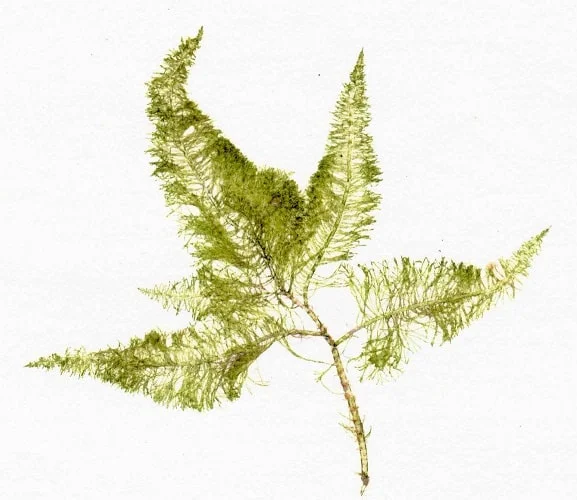

## Briopsis (Bryopsis)

**Nombre científico**: *Bryopsis pennata*, *Bryopsis plumosa*
**Tipo taxonómico**: Clorofita sifonal (sin tabiques celulares)
**Agua**: Exclusivamente marina
**Color**: Verde brillante, verde esmeralda
**Textura**: Plumosa, como una pequeña pluma de ave o helecho marino

**Aspecto**: Alga muy elegante estéticamente, con estructura plumosa ramificada que recuerda a una pluma o a una planta terrestre. Puede confundirse con una planta acuática ornamental. Crece en la roca viva formando pequeñas colonias que con el tiempo se expanden. Al tocarla se siente blanda y glutinosa.

**¿Es peligrosa?**: Una de las algas más problemáticas en marino. **Extremadamente resistente** a todos los métodos convencionales. Contiene compuestos alelopáticos que inhiben el crecimiento de corales. Una vez establecida puede ser muy difícil de erradicar.

**Parámetros relacionados**:
- **Magnesio (Mg) elevado**: Paradójicamente, hay una relación documentada: el Mg muy alto (> 1.500 ppm) puede inhibir su crecimiento
- **Nutrientes**: NO₃ y PO₄ elevados la alimentan
- **Algas resistentes**: Su estructura sifonada (sin tabiques) la hace resistente a herbicidas y peróxido

**Causas principales**:
1. Introducción con rocas vivas o corales no cuarentenados
2. Nutrientes elevados sostenidos
3. Baja presión de herbivoría

**Cómo eliminarla**:

- **Manual**: Arrancar de raíz — problema: los fragmentos son células completas y rebrotan. Deben extraerse hasta la última célula o hay rebrote.
- **Biológico**:
  - **Foxface** (*Siganus vulpinus*, *S. unimaculatus*) — los mejores consumidores de Bryopsis
  - **Tang/Cirujano** (*Zebrasoma* spp.) — con hambre, pueden comerla
  - **Cangrejos ermitaños** — comen en cantidad
  - **Nudibranquios** del género *Elysia* — especialistas pero difíciles de mantener
- **Método del Magnesio elevado**: Subir Mg a 1.400-1.600 ppm durante 2-4 semanas. Monitorizar Ca y KH. Los corales toleran este nivel temporalmente. Controversial pero reportado como efectivo por muchos acuaristas.
- **Fluconazol**: Antifúngico que actúa también contra algas sifonadas. Dosis: 10-20 mg/100L en agua del sump. Hacer cambio de agua grande antes. Requiere tiempo (2-4 semanas). No usar con pepinos de mar ni algunos equinodermos. Controvertido.
- **Peróxido de hidrógeno**: Directo sobre el alga fuera del agua (en decoración extraíble) o con micropipeta en el acuario (muy arriesgado con corales).
- **Cuarentena preventiva**: La mejor estrategia — todos los corales y rocas nuevas en cuarentena 4-6 semanas en tanque separado.

**Prevención**: Cuarentena estricta de todo material nuevo, nutrientes bajos, herbívoros activos.

---