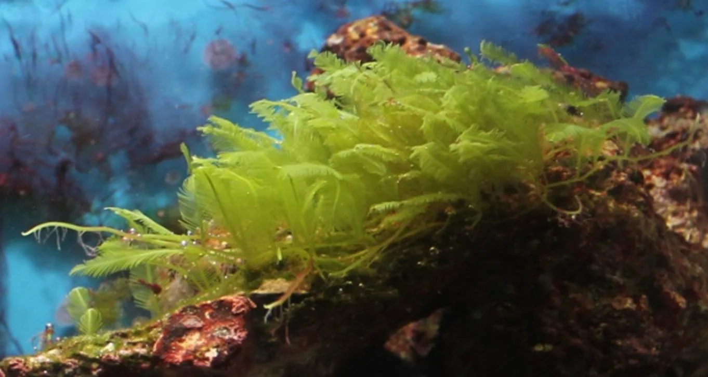

## Caulerpa

**Nombre científico**: *Caulerpa taxifolia*, *Caulerpa prolifera*, *Caulerpa racemosa*
**Tipo taxonómico**: Clorofita sifonada
**Agua**: Marina
**Color**: Verde intenso
**Textura**: Suave, estolones rastreros con frondes verticales de formas variadas según especie

**Aspecto**: Planta-alga rastrera con estolones que se fijan a la roca y frondas verticales. *C. racemosa* tiene frondas en forma de uva. *C. taxifolia* tiene frondas plumosas. *C. prolifera* tiene frondas lanceoladas.

**¿Es peligrosa?**:
- *C. taxifolia* es **invasora en el Mediterráneo** y su venta es ilegal en muchos países.
- En el acuario puede ser útil en el refugio para exportar nutrientes.
- En el display puede overgrow corales.
- Las plantas pueden "esporular" (reproducción sexual masiva) liberando gametos que envenenan el acuario completamente — esto ocurre cuando están bajo estrés.

**Uso correcto**: Mantener en refugio como exportador de nutrientes, podar regularmente (nunca dejar "esporular"), nunca en el display sin control.

**Cómo eliminarla**:
- **Manual**: Arrancar con cuidado, no dejar trozos (rebrota desde cualquier fragmento).
- **Herbívoros**: Tang, Foxface, Rabbitfish.
- **Oscuridad**: 3-5 días de oscuridad.

---