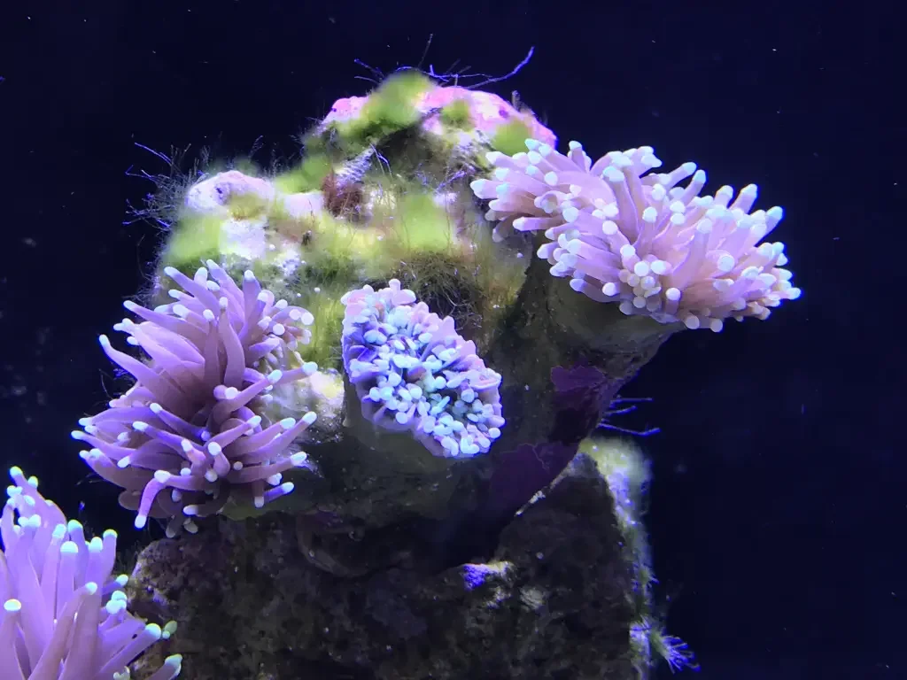

## Alga Pelo Verde Marina (GHA Marina)

**Nombre científico**: *Chaetomorpha linum*, *Bryopsis pennata*, varias *Cladophora* marinas
**Color**: Verde medio, verde brillante
**Aspecto**: Mechones filamentosos verdes similares al GHA de agua dulce, pero a menudo más gruesos y resistentes.

**¿Dónde aparece?**: Roca viva, decoración, parte trasera del sump.

**¿Es peligrosa?**: No directamente, pero puede asfixiar corales si los cubre.

**Causas principales**:
1. Nitratos (NO₃) > 5-10 ppm
2. Fosfatos (PO₄) > 0,05-0,1 ppm
3. Poca agitación en zonas de la roca

**Cómo eliminarla**:
- **Biológico**: **Tang** (cirujanos) — especialmente *Zebrasoma flavescens* (cirujano amarillo), *Ctenochaetus* (cirujano kole). **Foxface** (*Siganus vulpinus*). Cangrejos esmeralda (*Mithraculus sculptus*) para algas en grietas.
- **Manual**: Extraer manualmente con dedos o pinzas.
- **Refugio con Chaeto**: Cultivar *Chaetomorpha* (GHA no invasiva) en el refugio como exportador de nutrientes — compite con las algas invasoras.
- **Skimmer**: Optimizar el espumador para exportar más materia orgánica.
- **Reactor de nitrato y fosfato (NP reducer)**: Pellets de carbono para reducir nutrientes.
- **Quitar con H₂O₂**: En decoración extraíble, no dentro del acuario con corales.

---