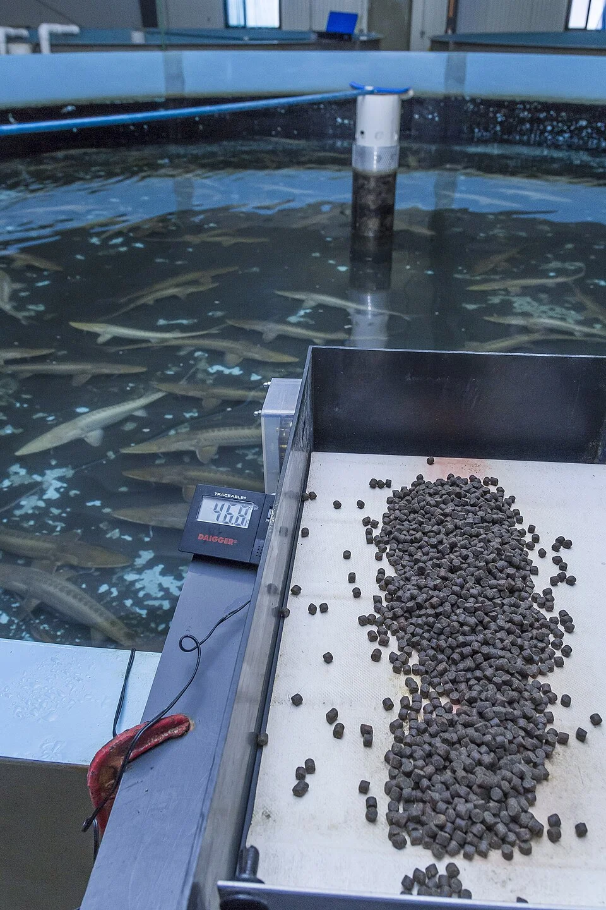

## AYUNO Y AUSENCIAS

### Cuánto aguantan los peces sin comer

| Tipo de pez | Días sin comer (salud normal) |
|-------------|-------------------------------|
| Peces tropicales adultos | 7-14 días |
| Alevines | 2-3 días máximo |
| Peces grandes (Oscar, Ciclidos) | 2-3 semanas |
| Bettas | 10-14 días |
| Peces de agua fría (baja temp) | 3-4 semanas |

### En vacaciones
- **Hasta 7 días**: No hace falta nada si los peces están sanos
- **7-14 días**: Comedero automático programable
- **Más de 14 días**: Comedero automático + cambio de agua antes de salir + pedir a alguien de confianza que supervise (no que alimente en exceso)

### Comederos automáticos
Dispensan pequeñas cantidades de alimento seco en horas programadas. Los mejores: Eheim Everyday Fish Feeder, IceCap Battery Powered Feeder.
- **Precaución**: Un fallo puede llenar el acuario de comida → muerte por amoniaco. Hacer pruebas antes.