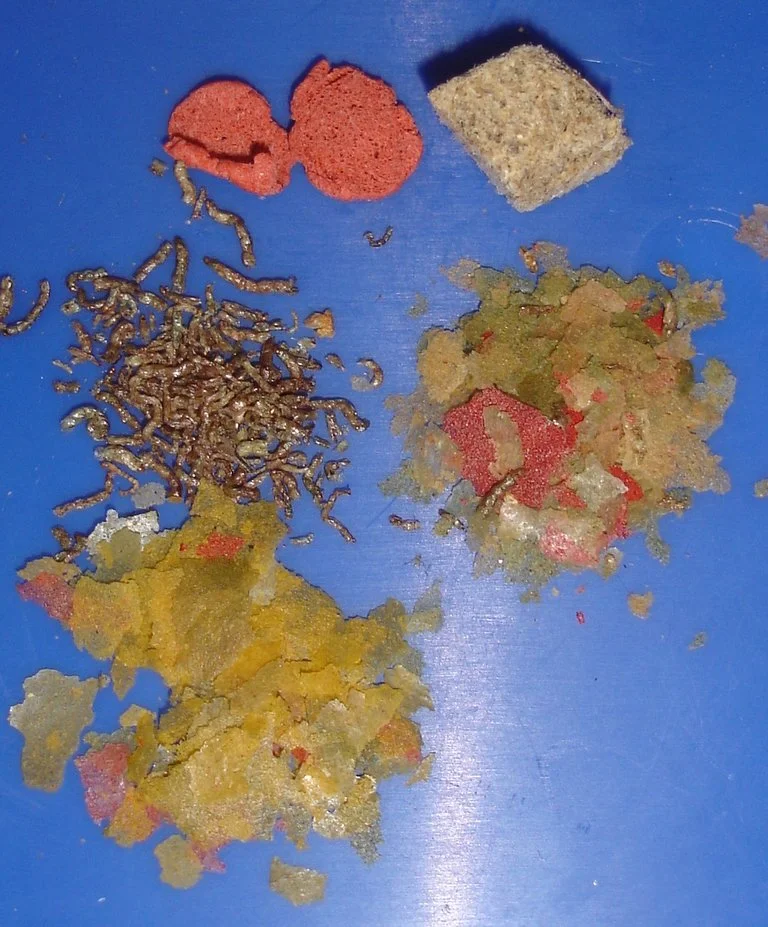

## DIETAS POR TIPO DE PEZ

### Carnívoros estrictos

- Bettas, ciclidos grandes, peces depredadores
- Base: mosquito rojo, artemia, cíclopes
- Pellets carnívoros de alta proteína (Hikari Bio-Gold, New Life Spectrum)
- Variedad es clave

### Omnívoros (la mayoría de peces de acuario)
- Dieta variada: escamas/pellets + congelados (artemia, mosquito) + vegetal ocasional
- Un día de dáfnia/vegetal ayuda al tracto digestivo

### Herbívoros (Goldfish, ciertos ciclidos, plecos herbívoros, tangs)
- Predominancia vegetal: espirulina, alga nori, verduras
- Verduras apropiadas: zucchini (calabacín), pepino, espinacas, lechuga
- Hervir ligeramente o escaldar para ablandar (salvo nori)
- Poca proteína animal o ninguna en herbívoros estrictos (puede dañar hígado/riñones a largo plazo)

### Algas y biofilm (otocinclus, pleco, gambas Neocaridina/Amano)
- No necesitan muchos extras si el acuario tiene algas naturales
- Suplementar con: wafers de espirulina, verduras escaladas, algas nori
- Las gambas también aprecian hoja de catappa, hoja de roble (contienen taninos y biofilm)

### Peces de fondo (corydoras, loricáridos)
- Pellets hundidores o wafers
- Verduras para los loricáridos (calabacín, zanahoria, pepino)
- Asegurarse de que la comida llega al fondo antes de que los peces de arriba se la coman

---