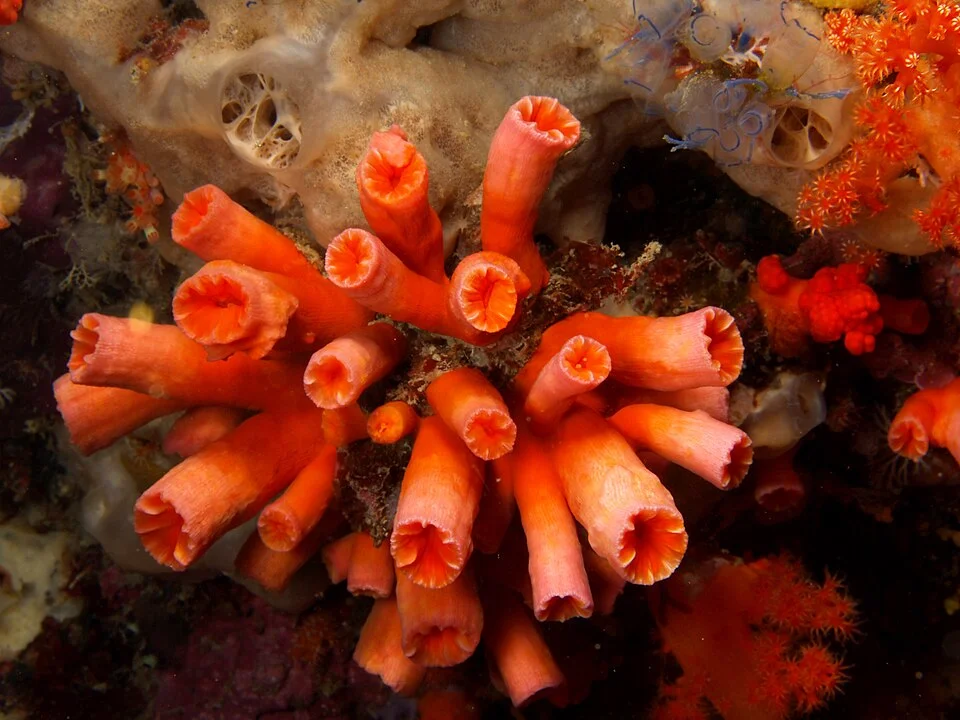

## ALIMENTACIÓN EN ACUARIO MARINO

### Peces marinos

- Dieta más variada y compleja que los de agua dulce
- Los peces de arrecife en natura comen a lo largo de todo el día → multiples tomas pequeñas son mejor

**Alimentos marinos:**
- Mysis, artemia, cíclopes
- Krill (para peces grandes)
- Alga nori (para tangs/herbívoros marinos)
- Pellets marinos
- Copépodos vivos (para mandarina, algunos peces difíciles)

### Corales
Los corales SPS y LPS se alimentan de materia orgánica del agua + fotosíntesis.

**Tipos de alimentación coral:**
- **Zooplacton**: Rotifers, copépodos, artemis nauplia (para LPS con pólipos grandes)
- **Fitoplancton**: Microalgas para corales filtradores (Gorgonias, esponjas)
- **Alimento líquido**: Reef Energy (Red Sea), Polyp Lab Reef-Roids, Coral Frenzy
- **Alimento en polvo/suspensión**: BRS Reef Chili, Brightwell Coral Amino

**Cómo dar alimento a corales**:
- Apagar la corriente 5-10 minutos
- Aplicar alimento directamente sobre los pólipos con pipeta/jeringuilla
- Reactivar circulación
- El alimento sobrante aumenta PO4/NO3 → no sobrealimentar

---