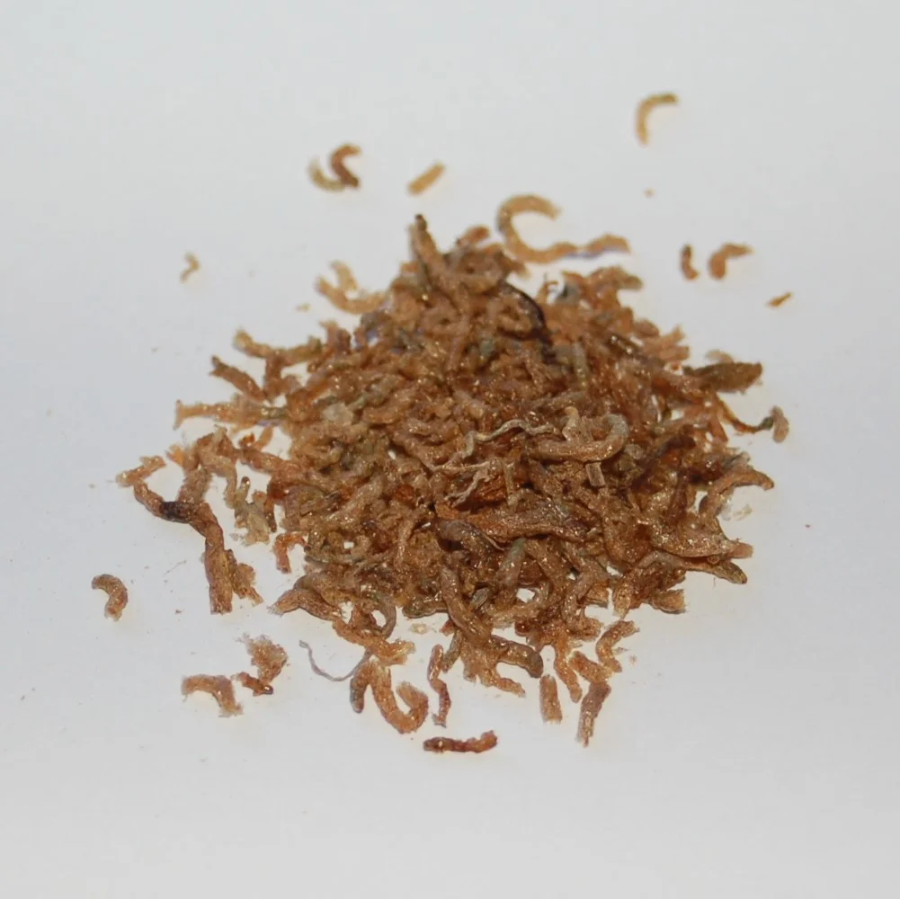

# Alimento congelado

El siguiente escalón de calidad. Se mantienen casi todos los nutrientes originales.

**Tipos más comunes:**

| Alimento | Para | Notas |
|----------|------|-------|
| Artemia adulta | Peces pequeños-medianos | Universal |
| Artemia nauplia | Alevines, peces nano | Muy nutritiva |
| Dáfnia | Todos | Ayuda a la digestión (tiene cutícula que actúa como fibra) |
| Mosquito rojo (Chironomus) | Todos, especialmente bettas | Muy apetecido, rico en proteínas |
| Tubifex | Carnívoros | Riesgo de parásitos si no está certificado |
| Mysis (gambas de agua dulce) | Peces medianos, marinos | Excelente |
| Cíclopes | Peces pequeños, gambas | Muy nutritivo |
| Krill | Peces grandes, marinos | Rico en astaxantina (color) |
| Vieira, mejillón | Peces grandes, marinos | Alimento de pesca, barato |

**Descongelación correcta**: En agua del acuario, nunca en agua caliente. Enjuagar bien antes de dar (el agua de descongelación tiene bacterias y fosfatos).

---