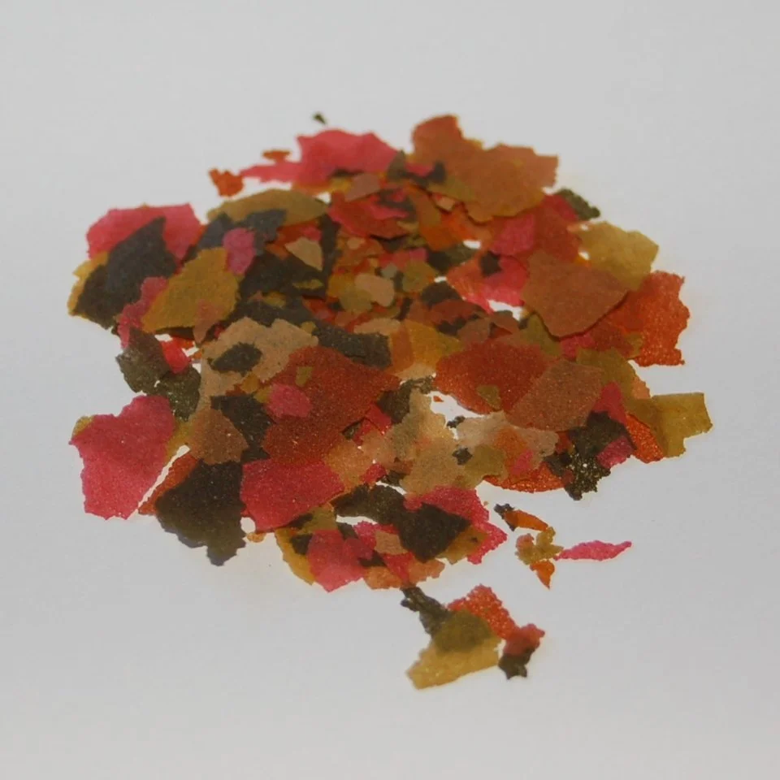

# Alimento seco

**Escamas (flakes)**
- El más común y cómodo
- Se deshacen rápido → enturbian el agua
- Válido para peces de superficie/medio
- Calidad varía enormemente → marcas buenas: Hikari, JBL, Tetra, New Life Spectrum

**Gránulos (pellets)**
- Se disuelven más lento que escamas
- Mejor para fondo y peces medianos/grandes
- Pellets hundidores para corydoras, loricáridos
- Pellets flotadores para bettas, peces de superficie

**Pastillas (wafers/tabs)**
- Para fondo: corydoras, loricáridos, plecos
- Zucchini/spirulina wafers para herbívoros de fondo

**Liofilizados (freeze-dried)**
- Tubifex, Artemia, Dáfnia, Krill deshidratados
- Nutrientes conservados, sin riesgo de parásitos
- Desventaja: pueden causar estreñimiento si son la única dieta
- Remojar antes de dar para evitar que se expandan en el estómago del pez

---