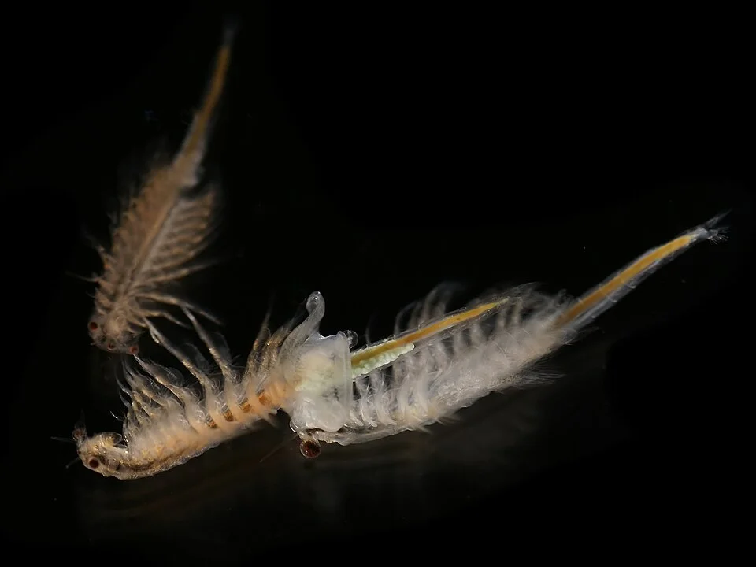

# Alimento vivo

El más nutritivo y estimulante del comportamiento natural. También el que más riesgo tiene de introducir parásitos.

**Los más usados:**

| Alimento | Para | Cultivo en casa |
|----------|------|-----------------|
| Artemia (nauplia) | Alevines, gambas | ✅ Fácil (incubadora de huevos) |
| Dáfnia | Todos | ✅ Posible (cubo exterior) |
| Tubifex | Carnívoros | ⚠️ Riesgo alto de parásitos |
| Grindal worm | Peces pequeños | ✅ Fácil (bandeja con fibra de coco) |
| Micro gusano (Microworm) | Alevines | ✅ Muy fácil (avena + levadura) |
| Gusano de la harina | Peces grandes | ✅ Fácil (caja de salvado) |
| Mosca de la fruta (Drosophila) | Killifish, peces superficie | ✅ Posible |
| Copépodos | Peces nano, mandarina marino | ✅ Posible pero lento |
| Gamba fantasma (adulta) | Peces grandes | ✅ Fácil de criar |

**Cultivo de Artemia nauplia** (más común):
1. Mezclar 25-35 ppt de sal marina en agua
2. Añadir huevos de artemia (cista)
3. Mantener a 28°C con aireación fuerte y luz
4. Eclosionan en 24-36h
5. Separar nauplia de la cáscara con linterna (las nauplia van a la luz)
6. Enjuagar antes de dar (el agua salada es tóxica en exceso)

---