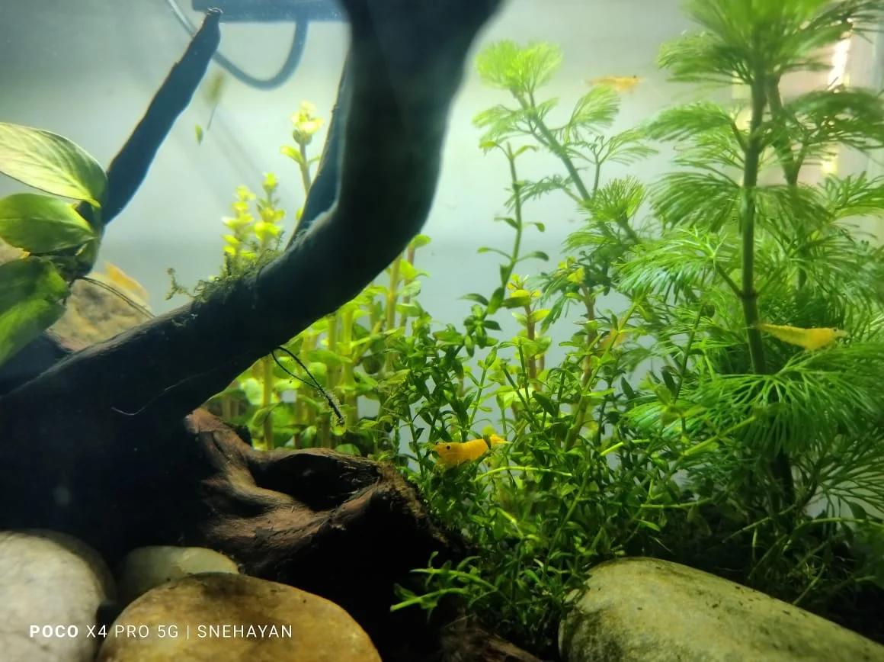

# Biotopo aquascape

El diseño reproduce fielmente un ecosistema real, con las mismas plantas, peces, sustrato y decoración que se encontrarían en esa zona geográfica.

---

### Paludario
Mitad acuario, mitad terrario. La zona emergida puede tener:
- Musgos y helechos terrestres
- Bromeliáceas, orquídeas miniatura
- Plantas tropicales
Ideal para anfibios (ranas de cristal, ranas de árbol), salamandras acuáticas, o simplemente como jardín húmedo.

---