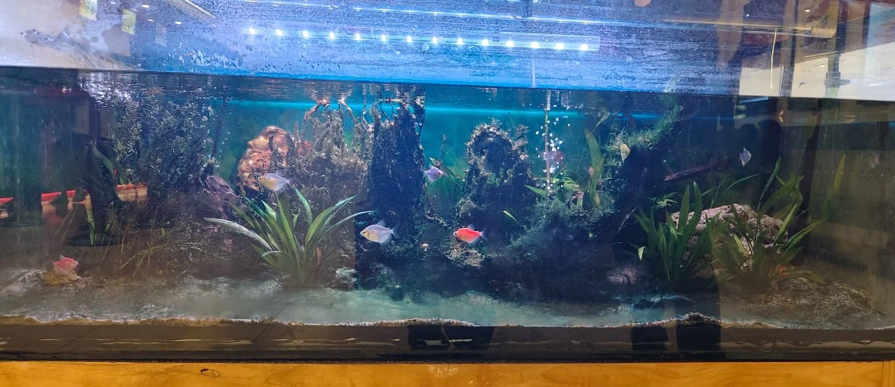

# Dutch Style (Estilo Holandés)

**Inspiración**: Jardines formales europeos
**Características**:
- Sin rocas ni madera como protagonistas
- Plantas en calles ordenadas por grupos de colores
- Altura progresiva de atrás hacia adelante
- Gran variedad de especies
- Los "caminos" diagonales crean perspectiva
- Colores contrastados: rojos vs verdes, texturas finas vs anchas

---