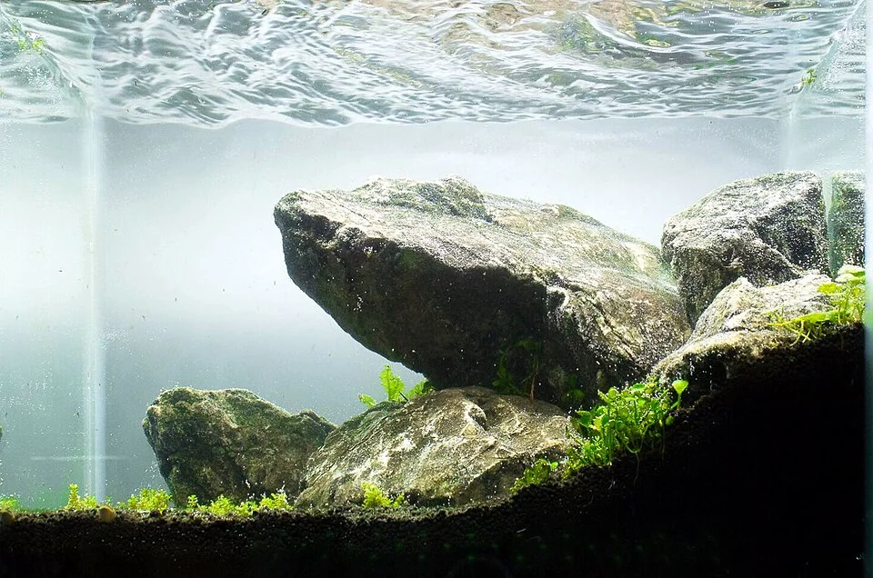

# Iwagumi

**Inspiración**: Jardines de piedra japoneses (karesansui)
**Características**:
- Solo rocas como elemento estructural (sin madera)
- Tapiz de plantas pequeñas (HC Cuba, Eleocharis, Glossostigma)
- Muy minimalista → cada detalle cuenta
- Las rocas se llaman Oyaishi (principal), Fukuishi (secundaria), Soeishi (complemento), Suteishi (piedras de sacrificio)
- Disposición odd-number (número impar de rocas principales)

**Parámetros**: Alta luz, CO2, sustrato activo, agua blanda — muy exigente técnicamente.

---