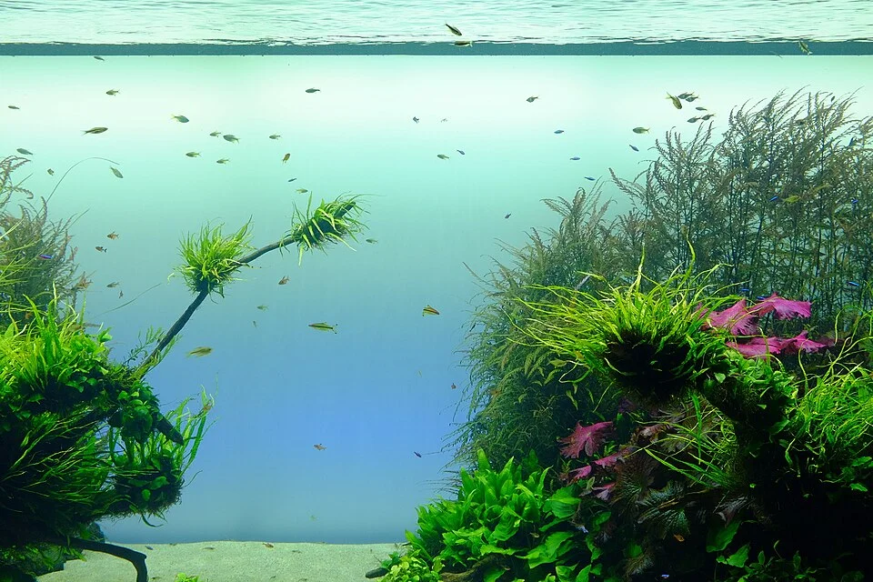

# Jungle Style

**Características**:
- Densa vegetación sin orden aparente
- Madera y raíces prominentes
- Sensación de selva tropical
- Más fácil de mantener que Iwagumi (no requiere tapiz perfecto)
- Los peces se mimetizan

---