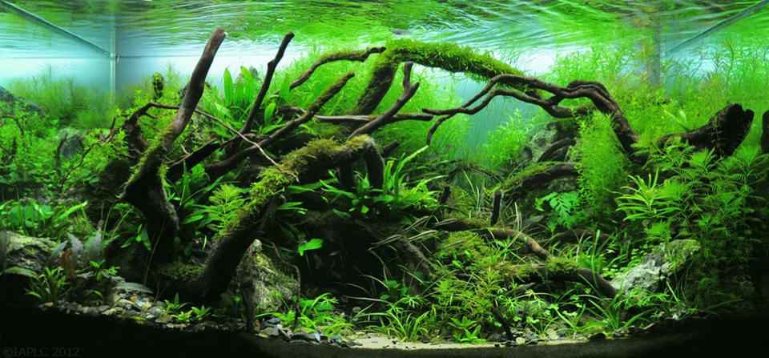

# Nature Aquarium (Takashi Amano)

**Inspiración**: Paisajes naturales japoneses (montañas, bosques, planicies)
**Características**:
- Armonía entre todos los elementos
- Uso del vacío (ma — espacio sin decorar tiene valor propio)
- Plantas en grupos cohesivos por especie
- Peces en banco que "viven" el paisaje, no son la atracción principal
- Alta dificultad técnica pero sensación de naturalidad

**Diseñador icónico**: Takashi Amano (fundador de ADA)

---