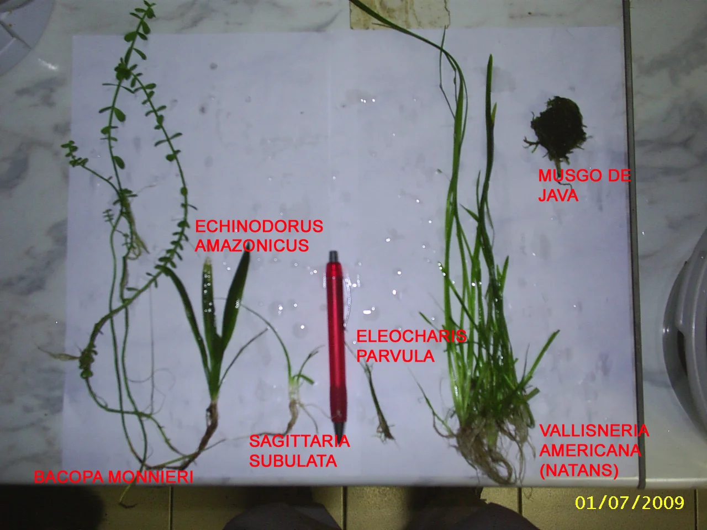

## MANTENIMIENTO DEL AQUASCAPE

### Poda de plantas

- **Plantas de tallo**: Cortar con tijeras a la altura deseada, plantar los esquejes obtenidos
- **Tapizantes**: Cortar en "parches" con tijeras curvas o tijeras de aquascaping
- **Anubias**: Retirar hojas viejas (con manchas de algas o marrones) para estimular crecimiento nuevo
- **Musgos**: Cortar y sacar la parte que sobresalga del diseño

**Frecuencia**: Semanal en plantados de crecimiento rápido con CO2. Mensual en plantados sin CO2.

### Materiales de aquascaping

| Herramienta | Uso |
|-------------|-----|
| Tijeras curvas | Poda de plantas en primer plano y tapizantes |
| Tijeras rectas | Plantas de tallo y medianas |
| Pinzas rectas | Plantar y manipular en zonas accesibles |
| Pinzas curvas | Zonas de difícil acceso, primer plano |
| Espátula de sustrato | Ajustar el sustrato sin enturbiar el agua |
| Rasqueta de algas | Limpiar el cristal frontal |
| Imán limpiador | Limpiar cristal sin mojarse la mano |