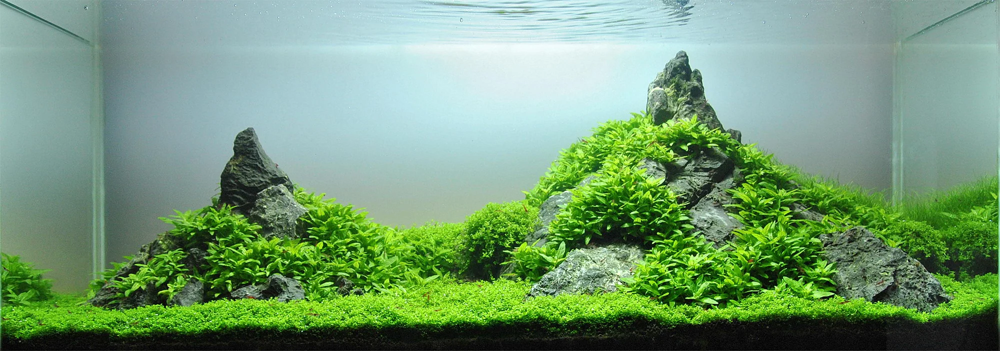

## MATERIALES Y SUSTRATOS

### Rocas

| Tipo | Características | Efecto en agua |
|------|-----------------|----------------|
| Seiryu Stone | Gris azulada, veins blancos | Sube KH y pH (calcárea) |
| Dragon Stone (Ohko) | Marrón con agujeros irregulares | Sube ligeramente KH |
| Lava Rock | Negra/rojiza, muy porosa | Inerte o mínimo efecto |
| Yamaya Stone | Gris claro con fracturas | Sube KH |
| Pagoda Stone | Apilamiento horizontal | Sube KH |
| Talón Stone | Blanca, calcárea evidente | Sube mucho KH — precaución |
| Piedra caliza / Caliza marina | Blanca/crema | Sube KH y pH significativamente |

**Test del vinagre**: Echar unas gotas de vinagre sobre la roca. Si burbujea → contiene calcio/carbonatos → subirá el KH. Sin burbujas → inerte.

**Rockscaping**: Las rocas de la misma familia/color se ven más naturales que mezclar tipos.

---

### Madera

| Tipo | Características |
|------|-----------------|
| Raíz de pagoda / Mopani | Densa, se hunde sola, libera taninos moderados |
| Raíz de Malayo (Malaysian) | Formas serpenteantes naturales |
| Raíz de Spider / Bonsai | Ramas finas ideales para musgo y helechos |
| Madera de Cholla | Tubular, porosa, se descompone en 1-2 años |
| Tallos de bambú (estabilizados) | Modernos, no liberan mucho |
| Raíz de Bogwood | Antigua madera pantanosa — muy oscura, mucho tanino |

**Preparación de la madera**:
1. Hervir o remojar varias semanas (quita hongos y taninos)
2. Los primeros meses liberarán algo de tanino (agua amarillenta) → normal, no dañino
3. Si flota → atar a una piedra o en un cubo con peso hasta que se sature

**Hongos en madera nueva**: Los hongos blancos que aparecen en madera nueva son normales (celulosa superficial). Los come cualquier pez. Desaparecen solos en 1-2 semanas.

---

### Sustratos

**Para plantado:**

| Sustrato | Características |
|----------|-----------------|
| ADA Aqua Soil Amazonia | El estándar de calidad. Activo — acidifica y ablanda. Libera amoniaco al inicio. |
| Tropica Aquarium Soil | Similar a ADA. Muy popular en Europa. |
| Fluval Stratum | Para gambas Caridina y plantado. Más asequible. |
| JBL ProScape | Activo, buena capacidad tamponante |
| Controsoil (Up Aqua) | Económico, funcional |
| Lecho de turba (peat) | Natural, acidifica, pero poco práctico |
| Arena fina (0.1-1 mm) | Inerte, ideal para Corydoras, gambas |
| Grava de acuario | No nutritiva, solo decorativa para plantado |

**Sustrato activo**: Libera nutrientes, acidifica y ablanda el agua. Necesario para Caridina. Se agota en 12-18 meses (pierde capacidad de buffering) → en gambas hay que renovarlo.

**Sustrato inerte**: Arena de cuarzo, grava de acuario. No modifica parámetros. Para Neocaridina, ciclidos africanos, goldfish.

**Profundidad recomendada**: 5-8 cm en plantado (raíces profundas de Echinodorus necesitan espacio). Mínimo 3 cm.

---