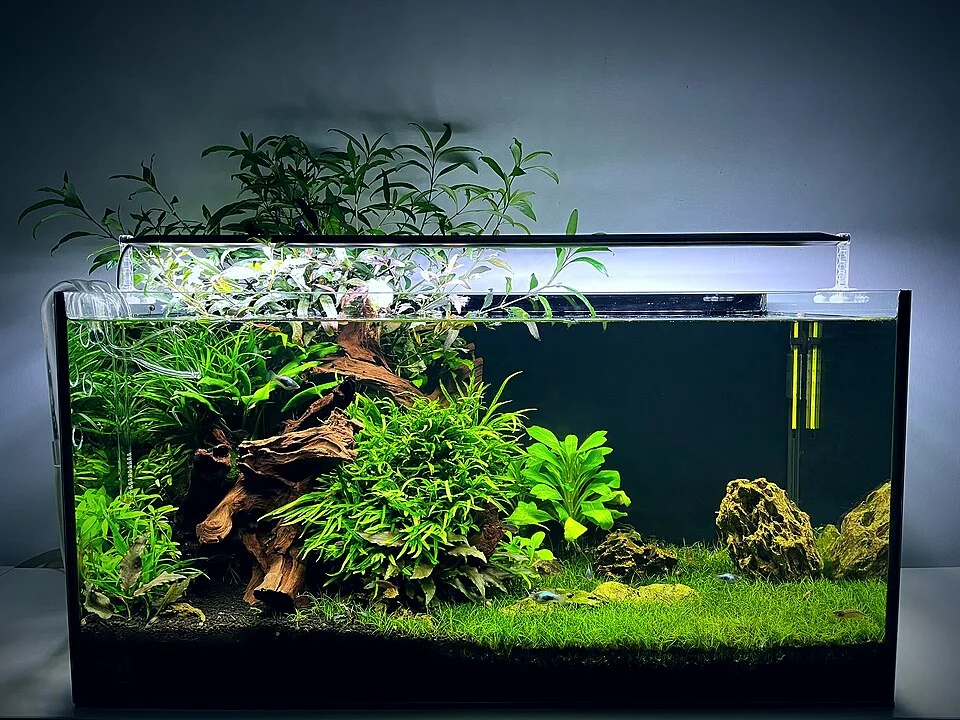

## PRINCIPIOS DE DISEÑO



### Regla de los tercios

Dividir el acuario en una cuadrícula de 3x3. Los puntos de intersección son los focos de atención naturales donde colocar los elementos principales.

```diagram-rule-of-thirds
┌─────┬─────┬─────┐
│     │  X  │     │  ← X = puntos de interés
├─────┼─────┼─────┤
│     │     │  X  │
├─────┼─────┼─────┤
│     │  X  │     │
└─────┴─────┴─────┘
```

### El punto focal (focal point)
Todo diseño necesita un elemento dominante que capture la atención. Puede ser una roca grande, un árbol de musgo, un coral espectacular.

### Triangulación
Los elementos se organizan formando triángulos asimétricos. Crea sensación de profundidad y naturalidad. El diseño clásico tiene un punto alto a un lado y descende hacia el otro.

### Profundidad
- **Primer plano**: plantas pequeñas, sustrato de grano fino
- **Plano medio**: rocas, maderas, plantas medianas
- **Fondo**: plantas altas, paredes de roca, decoración grande
- **Perspectiva**: objetos más pequeños al fondo crean ilusión de profundidad (perspectiva forzada)

### Proporción áurea (número de Fibonacci)
La "espiral dorada" de Fibonacci aparece en la naturaleza. En aquascaping se usa para posicionar los elementos principales. Punto focal en la relación 1:1.618 desde el lateral.

### Wabi-sabi (filosofía japonesa)
Belleza en la imperfección y la impermanencia. Los mejores diseños no son perfectamente simétricos — tienen asimetría intencionada, elementos "imperfectos" que los hacen parecer más naturales.

---