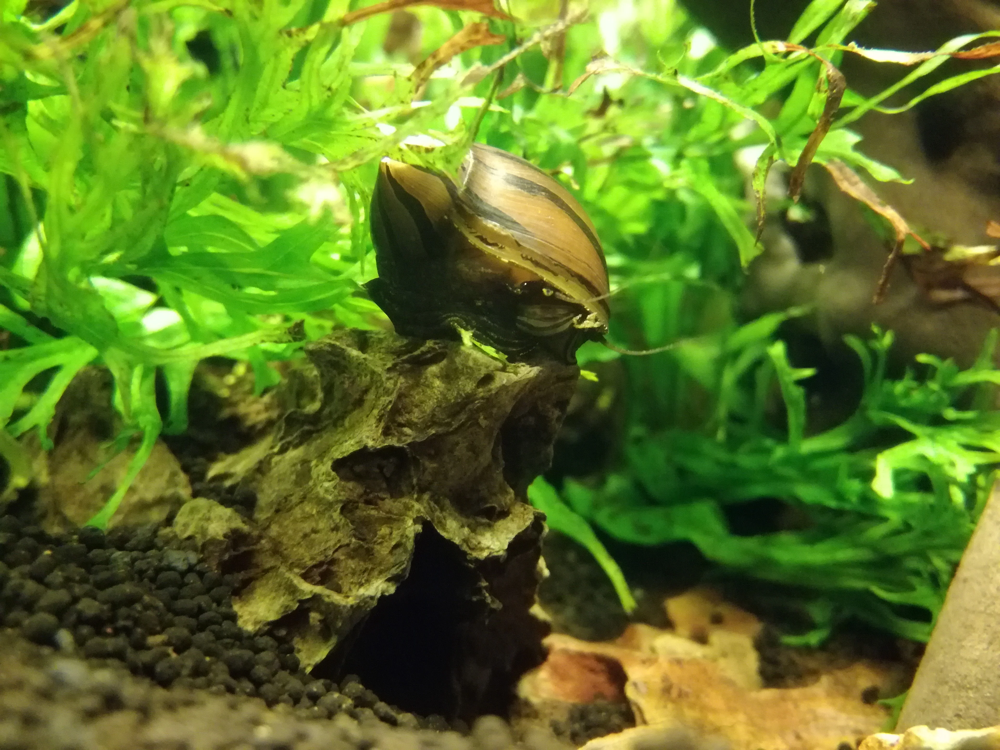

## Biología de caracoles de acuario

### Tipos comunes y su biología

**Caracoles Nerite (Neritina spp.)**
- Se reproducen en agua salobre → no invaden acuarios de agua dulce
- Ponen huevos blancos que no eclosionan en dulce (molestia estética pero inofensivos)
- Los mejores comeralgas del acuario
- Longevidad: 1-2 años

**Caracoles Manzana (Pomacea spp.)**
- Los más grandes (hasta 10 cm)
- Pueden comer plantas blandas
- Ponen huevos fucsia fuera del agua (sobre la tapa)
- Separar machos de hembras para no reproducirse en exceso

**Caracoles de cuerno/Ramshorn (Planorbarius corneus)**
- Hermafroditas → se reproducen solos
- Plaga potencial si hay exceso de comida
- Útiles como limpiadores del sustrato
- Existen variedades rojas o rosadas por selección

**Misterio Snail (Pomacea bridgesii)**
- Similar al manzana pero más pequeño
- No come plantas sanas
- Se reproducen más lentamente
- Buen limpiador

**Physa/Physella**
- Plaga común → aparecen solos desde plantas compradas
- Se reproducen masivamente
- Útiles en pequeñas cantidades (limpian restos), problemáticos en exceso

---