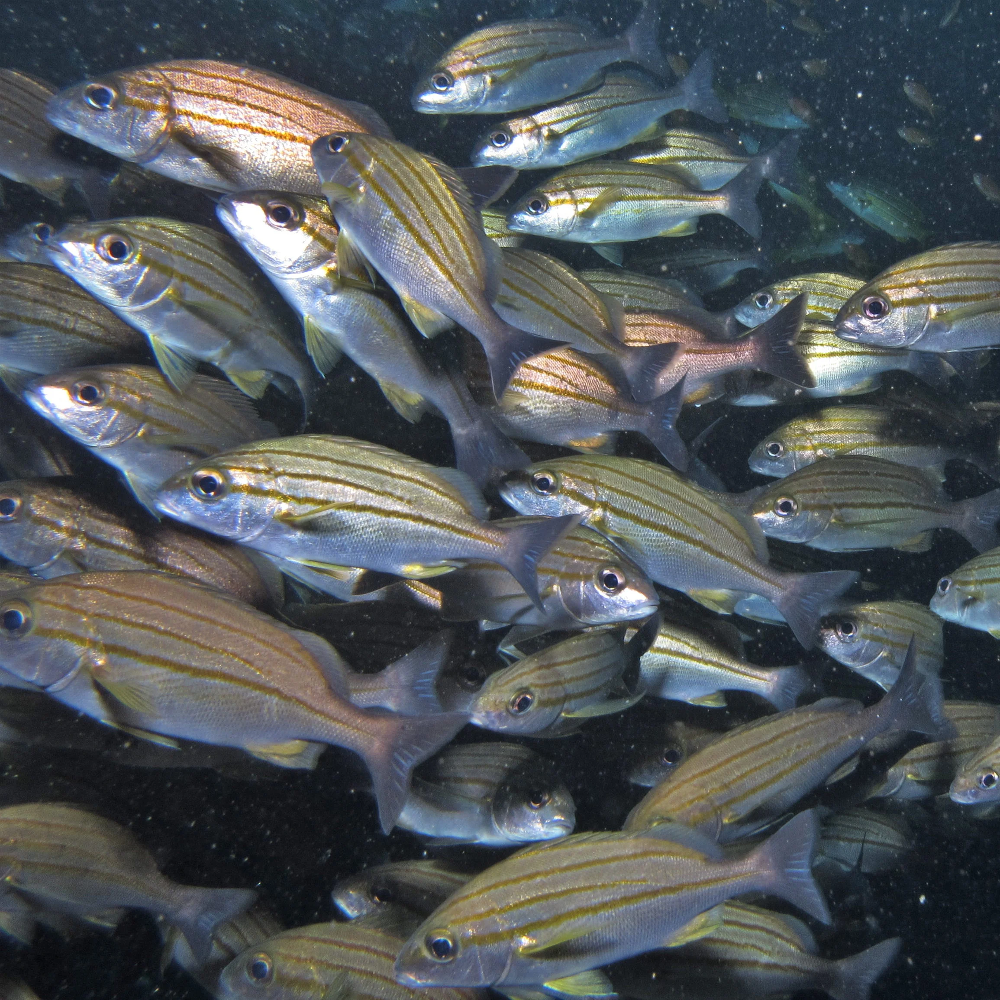

## Comportamientos relevantes en acuario

### Comportamiento de banco (shoaling vs schooling)

- **Shoaling**: Agrupación social — los peces prefieren estar juntos pero no se mueven coordinados
- **Schooling**: Banco sincronizado — movimiento coordinado, anti-depredador
- Los tetras, rasboras, danios son "schooling" → mínimo 6 ejemplares para comportamiento natural

### Territorialidad

- **Ciclidos**: Muchas especies marcan territorio, especialmente en cría. Separar físicamente o con decoración que rompa líneas de visión
- **Bettas**: Machos muy agresivos entre sí y con peces de colores vivos similares
- **Peces globo (Tetraodontidae)**: Muerden aletas de otros peces

### Jerarquía y dominancia

- Muchos peces tienen jerarquía de dominancia
- El individuo dominante puede acosar a los subordinados → necesario suficiente espacio y escondites
- En grupos impares o mayores, el acoso se distribuye y ningún individuo recibe todo el estrés

### Saltar fuera del acuario

- Muchas especies saltan (especialmente: Killifish, Archerfish, Hatchetfish, Danios)
- **Siempre usar tapa** en acuarios con estas especies

### Comunicación química

- Los peces liberan **feromonas** y **sustancias de alarma** (Schreckstoff)
- Cuando un pez es atacado, libera sustancias que avisan al banco de peligro
- El olfato es fundamental en Corydoras para encontrar comida

---

## El ecosistema del acuario