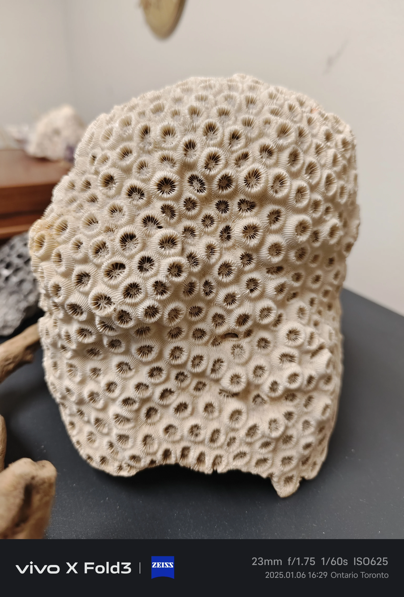

## Biología de corales

### ¿Qué son los corales?
Los corales son animales (Cnidaria, clase Anthozoa) que viven en simbiosis con algas fotosintéticas llamadas **zooxantelas** (Symbiodinium sp.). Las zooxantelas:
- Viven dentro de los tejidos del coral
- Realizan fotosíntesis → aportan hasta el 90% de la energía del coral
- Le dan la coloración al coral

### El blanqueamiento del coral
Cuando el coral está estresado (temperatura alta, luz intensa, contaminación), expulsa las zooxantelas → pierde color → sin energía fotosintética → puede morir.

### Tipos de corales por requerimientos

**SPS (Small Polyp Stony) — Piedra dura de pólipo pequeño**
- Ejemplos: Acropora, Montipora, Pocillopora, Stylophora
- Alta luz, alta corriente
- Muy sensibles a parámetros (NO3 <5, PO4 <0.05)
- Para acuaristas avanzados

**LPS (Large Polyp Stony) — Piedra dura de pólipo grande**
- Ejemplos: Favia, Acanthastrea, Hammer, Blastomussa, Goniopora, Trachyphyllia
- Luz y corriente moderadas
- Más tolerantes a fluctuaciones
- Buenos para iniciarss en corales

**Blandos (Soft Corals)**
- Ejemplos: Zoanthus, Palythoa, Sarcophyton, Xenia, Clavularia
- Muy tolerantes, sin esqueleto calcáreo
- No requieren dosificación de Ca/Alk tan estricta
- Ideales para empezar en marino

### Calcificación
Corales SPS y LPS forman esqueleto de aragonito (CaCO3). Requieren:
- Calcio: 380-450 ppm
- Alcalinidad: 8-12 dKH
- Magnesio: 1200-1400 ppm (importante para que Ca y KH no precipiten)

---