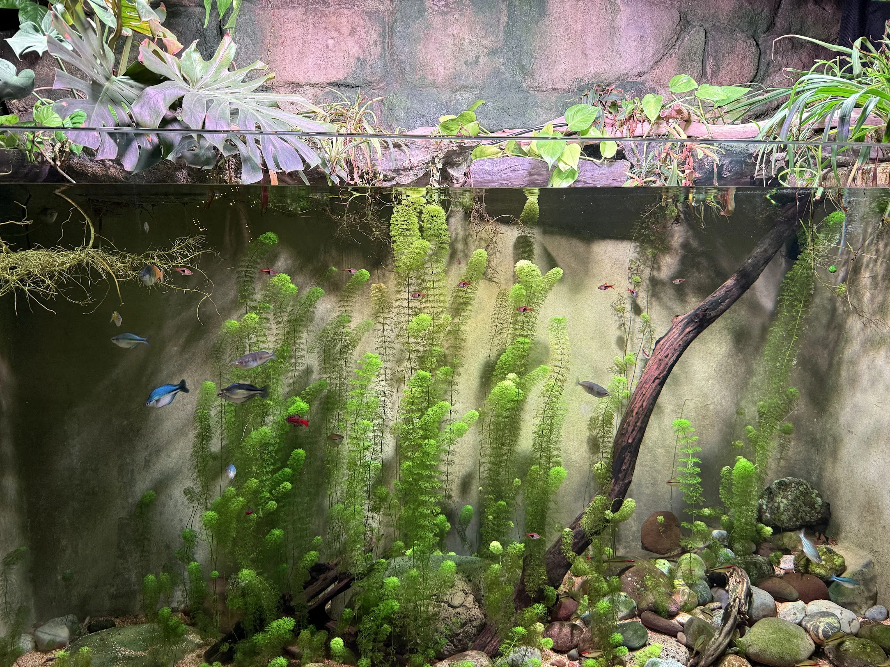

### Cadena de nutrientes en el acuario



```diagram-ecosystem-chain
Luz solar/artificial
        ↓
   PRODUCTORES (Algas, plantas)
        ↓
CONSUMIDORES PRIMARIOS (Herbívoros: otocinclus, ciertos ciclidos)
        ↓
CONSUMIDORES SECUNDARIOS (Omnívoros, carnívoros pequeños)
        ↓
DESCOMPONEDORES (Bacterias, hongos)
        ↓
NUTRIENTES MINERALES (NO3, PO4, CO2...)
        ↓
(Ciclo se reinicia)
```

### El papel de la microfauna

- **Copépodos**: Crustáceos microscópicos — alimento natural vivo excelente para peces pequeños y corales
- **Anfípodos**: Crustáceos bentónicos — limpiadores del fondo
- **Nemátodos**: Gusanos redondos microscópicos — descomponen materia orgánica
- **Protozoarios**: Descomposición inicial de materia orgánica
- En **marinos**: fauna del macro-live rock (esponjas, gusanos tubícolas, microcrustáceos) esencial para estabilidad

### Alelopatía

Algunas plantas liberan sustancias químicas que inhiben el crecimiento de otras (alelopatía):
- Vallisneria puede inhibir el crecimiento en su entorno inmediato
- Los taninos de la madera afectan el pH y algunas plantas

### Biofilm

Película de bacterias, algas y polisacáridos que se forma en superficies. En acuarios es:
- **Alimento esencial** para gambas (ramonean constantemente)
- **Normal y saludable** — no eliminarlo completamente
- Base de la red trófica bentónica