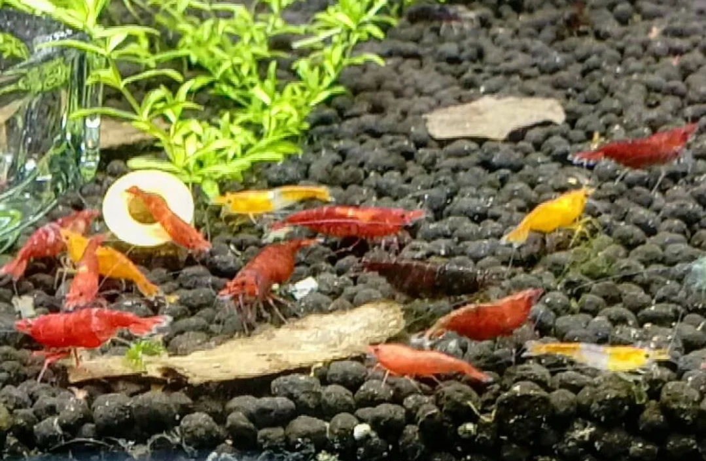

## Biología de gambas de acuario

### Ciclo vital

1. **Huevos**: La hembra lleva los huevos bajo el abdomen (entre los pleopodos) durante 3-5 semanas
2. **Larvas**: Eclosionan como réplicas diminutas del adulto (no hay fase larvaria pelágica como en gambas marinas de zoocriadero)
3. **Juveniles**: Crecen en 6-10 semanas hasta adulto
4. **Adulto**: 1-2 años de vida en Neocaridina; pueden reproducirse toda su vida

### La muda (ecdisis)
Las gambas tienen exoesqueleto de quitina que no crece → deben mudarlo para crecer.

**Proceso:**
1. Dejan de comer 1-2 días antes
2. Secretan enzimas que disuelven la capa interna
3. Se esconden y sacan el cuerpo por la parte posterior
4. Nueva capa blanda → muy vulnerables durante 12-24h
5. Endurecimiento con Ca del agua

**Problemas de muda:**
- **Failed molt / Muda atascada**: La gamba no puede salir completamente → muere
- Causas: GH bajo, Ca bajo, KH inestable, tóxicos en el agua (cobre)
- La hormona **crustecdisona** controla el ciclo; el cobre la altera

### Diferenciación sexual
- **Hembra**: más grande, abdomen redondeado (para llevar huevos), color más intenso generalmente
- **Macho**: más pequeño, abdomen recto, cola más corta
- **Hembra madura**: se ve la "silla de montar" (mancha en el dorso donde se forman los huevos antes de fertilizar)

---