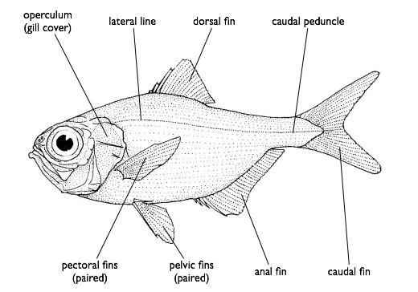

## Anatomía básica de los peces

### Sistemas principales

**Sistema tegumentario (piel y escamas)**
- **Escamas cicloides**: suaves, redondeadas (carpas, tetras, salmónidos)
- **Escamas ctenoides**: con dientes en el borde posterior (perciformes, ciclidos)
- **Escamas ganoideas**: duras, no se superponen (peces primitivos: polypteros, pez espátula)
- **Sin escamas**: silúridos (barbos, corydoras), anguilas
- La piel produce **moco** que protege contra patógenos y reduce fricción

**Sistema respiratorio**
- Las **branquias** intercambian O2/CO2 con el agua
- Flujo del agua: boca → faringe → branquias → opérculo
- Peces laberintios (Betta, Gourami): órgano laberíntico que permite respirar aire atmosférico
- Peces eléctricos, pulmones: algunas especies pueden respirar parcialmente fuera del agua

**Sistema lateral (línea lateral)**
- Detecta vibraciones y cambios de presión del agua
- Esencial para moverse en banco, detectar depredadores y presas
- Se daña con contaminantes, cloro y cambios bruscos de temperatura

**Vejiga natatoria**
- Órgano hidroestático que controla la flotabilidad
- Al ajustar el volumen de gas, el pez sube o baja sin nadar
- Problemas: "enfermedad de la vejiga natatoria" — peces que nadan de lado o no pueden sumergirse

**Sistema digestivo**
- Variable según la dieta:
  - Carnívoros: intestino corto, estómago potente
  - Herbívoros: intestino largo (para descomponer celulosa)
  - Omnívoros: intermedio

---