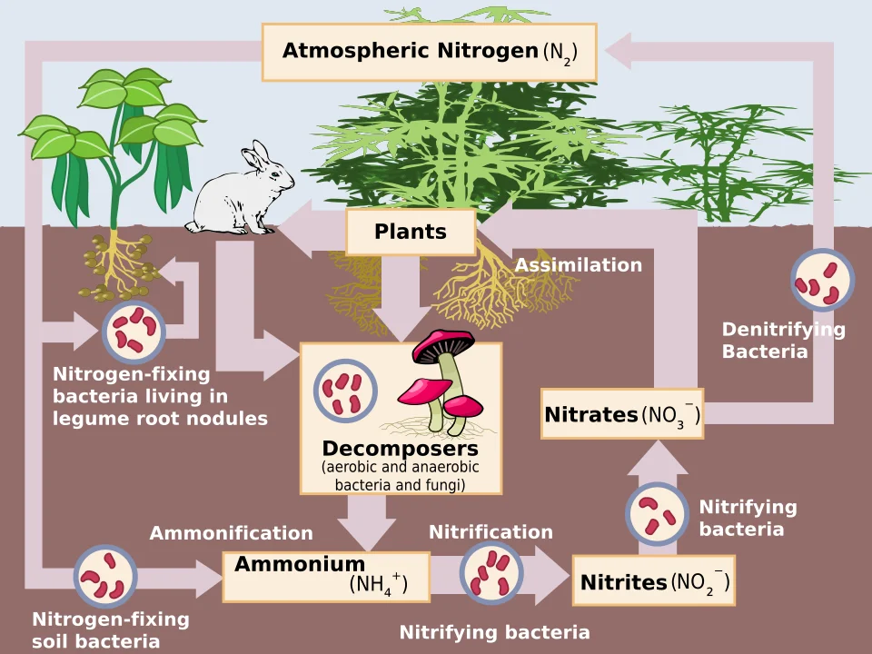

## El ciclo del nitrógeno (lo más importante de todo)



El ciclo del nitrógeno es el proceso biológico más crítico de cualquier acuario. Sin comprenderlo, es imposible mantener un acuario saludable.

### El proceso paso a paso

```diagram-nitrogen-cycle
Materia orgánica (restos de comida, heces, peces muertos)
        ↓
    AMONIACO (NH3 / NH4+)  ← TÓXICO para los peces
        ↓
    Bacterias Nitrosomonas
        ↓
    NITRITOS (NO2-)  ← TAMBIÉN TÓXICO
        ↓
    Bacterias Nitrobacter / Nitrospira
        ↓
    NITRATOS (NO3-)  ← Menos tóxico, se elimina con cambios de agua
        ↓
    (Plantas lo absorben o lo eliminamos nosotros con cambios de agua)
```

### Las bacterias nitrificantes

Son el "filtro biológico". Viven en:
- El sustrato del filtro (esponjas, cerámica porosa, biobolas)
- El sustrato del fondo
- Decoración (rocas, raíces)
- En menor medida, en el agua

Tardan **4-8 semanas** en colonizar un acuario nuevo → esto es lo que llamamos "madurar" el acuario.

### Por qué mueren las bacterias

- Cloro del agua del grifo (siempre usar acondicionador de agua)
- Limpiar el filtro con agua del grifo
- Antibióticos o medicamentos en el agua
- Cambios drásticos de temperatura
- Falta de oxígeno (necesitan O2)

---