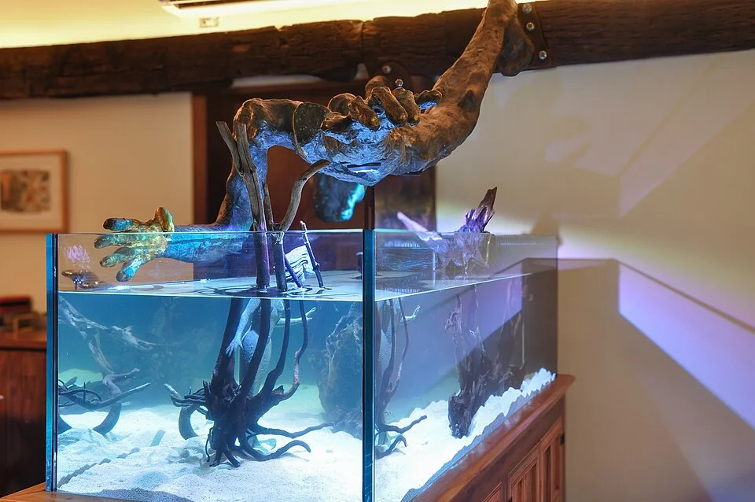

## Maduración del acuario (cycling)

### El ciclo completo en un acuario nuevo

**Semana 1-2:** El amoniaco sube (aún no hay bacterias suficientes)
**Semana 2-3:** El amoniaco baja, suben los nitritos (Nitrosomonas establece colonia)
**Semana 3-6:** Los nitritos bajan, suben los nitratos (Nitrobacter se establece)
**Semana 6-8:** NH3=0, NO2=0, NO3 presente → acuario maduro y listo

### Métodos de maduración

| Método | Descripción | Ventajas | Inconvenientes |
|--------|-------------|----------|----------------|
| Sin peces (fishless cycling) | Se añade amoniaco puro o comida sin peces | Más humano | Más lento |
| Con peces resistentes | Añadir pocos peces muy resistentes (Danios, Gambusias) | Más rápido | Estresa/mata peces |
| Con bacteria embotellada | Productos como Tetra SafeStart, Dr. Tim's | Muy rápido (días) | Resultados variables |
| Transferencia de filtro maduro | Llevar sustrato del filtro de otro acuario | Más rápido y fiable | Necesita un acuario donor |
| Con plantas vivas | Las plantas absorben NH3 y NO3 acelerando el proceso | Natural | Requiere luz |

### Señales de que el acuario está maduro
- Amoniaco: 0 ppm
- Nitritos: 0 ppm
- Nitratos: >0 ppm (presentes pero bajos)
- El ciclo se estabiliza aunque eches comida

---

## Volumen y dimensiones del acuario

### Reglas generales (orientativas)

- **Regla del centímetro**: 1 cm de pez por cada litro de agua (muy simplista, ignorar para peces grandes)
- **Regla real**: Considerar el comportamiento del pez, si nada en banco, necesita espacio lateral
- **Tamaño mínimo**: Nunca menos de 54L para cualquier configuración "permanente"

### Tipos por volumen

| Nombre | Litros | Características |
|--------|--------|-----------------|
| Nano acuario | <30L | Para gambas, peces muy pequeños, solo expertos |
| Acuario pequeño | 30-80L | Buenos para comenzar con grupos pequeños |
| Acuario mediano | 80-200L | Permite más opciones, más estable |
| Acuario grande | 200-500L | Estabilidad química mayor, más especies posibles |
| Mega acuario | >500L | Para peces grandes, marinos avanzados |

### Importancia de la superficie (no solo el volumen)

La superficie del agua determina el intercambio de O2/CO2. Un acuario alto y estrecho tiene menos superficie que uno bajo y largo con los mismos litros → peor oxigenación.

---

## Compatibilidad de especies

### Factores a considerar