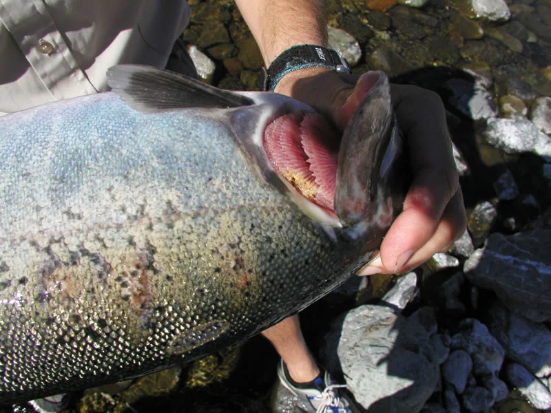
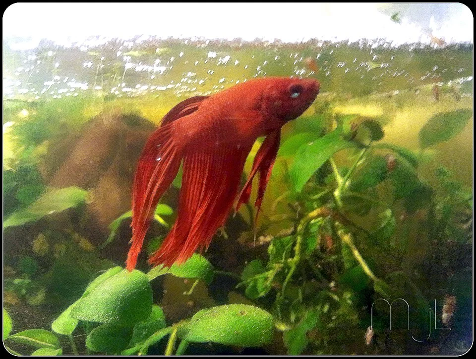

### Columnaris / Podredumbre de aleta / Saddleback (Flavobacterium columnare)

**Síntomas**:
- Aletas desflecadas y pudiéndose
- Manchas blanquecinas en el cuerpo (no son granos como ich)
- Lesiones grisáceas en la espalda (saddleback)
- Muerte en 24-72h en formas agudas
**Causa**: Bacteria aeróbica, aparece con estrés y agua de mala calidad
**Tratamiento:**
- Antibiótico: Kanamicina, Eritromicina (Maracyn), Cotrimoxazol
- Sal de roca (1-2 g/L) en agua dulce como coadyuvante
- Mejorar calidad del agua

---

### Aeromonas (Aeromonas hydrophila / salmonicida) — Podredumbre bacteriana

**Síntomas**: Ulceraciones en la piel, hemorragias, escamas levantadas (hydrops), branquias necróticas
**Causa**: Bacteria oportunista → aparece con peces estresados, agua sucia, parasitosis previas
**Tratamiento:**
- Antibiótico interno (kanamicina, ciprofloxacino en alimento medicado)
- Tratamiento de baño (cuando es externo)
- Mejorar calidad del agua drásticamente

---

### Enfermedad de hoyo en la cabeza / HLLE (Head and Lateral Line Erosion)
**Síntomas**: Lesiones cráter en la cabeza y línea lateral, principalmente en Discus, Oscarfish, Acanthurus
**Causa**: Aún debatida — probablemente déficit nutricional (vitamina C, mineral) + calidad de agua + Hexamita (parásito intestinal)
**Tratamiento:**
- Mejorar alimentación (vegetales, vitaminas)
- Mejorar calidad del agua
- Metronidazol (si hay Hexamita)

---

### Mycobacteriosis (Mycobacterium marinum / fortuitum)
**Síntomas**: Adelgazamiento crónico, lesiones internas, palidez, espina curvada (scoliosis)
**Causa**: Bacteria intracelular, muy resistente
**Zoonosis**: Puede infectar humanos en heridas abiertas (granuloma de piscina). Usar guantes.
**Tratamiento**: Muy difícil, prácticamente incurable. Sacrificio humanitario del pez afectado. Desinfectar el acuario.

---

## ENFERMEDADES FÚNGICAS

### Saprolegnia (Saprolegniasis)
**Síntomas**: Filamentos blancos o grisáceos algodonosos sobre heridas, huevos no fertilizados, peces debilitados
**Causa**: Agua moho (hongo acuático), oportunista
**Tratamiento:**
- Verde malaquita (muy efectivo)
- Sal de roca (1-3 g/L) — no para peces sensibles a sal
- Mejorar condiciones generales

---

## ENFERMEDADES VIRALES

### Linfocistis
**Síntomas**: Nódulos blancos parecidos a flores de coliflor en aletas y piel
**Causa**: Iridovirus
**Tratamiento**: Sin tratamiento. La mayoría se resuelve solo en semanas/meses. No fatal. Aislar para evitar contagio. No estrés.

---

### Iridovirus de gurami (DGIV)
**Síntomas**: Letargo, hinchazón, muerte en días
**Afecta**: Principalmente Trichogaster lalius (gurami enano)
**Tratamiento**: Sin tratamiento. Solo comprar de proveedores de confianza, evitar importados de Asia (alta prevalencia).

---

### Síndrome del neón (Pleistophora hyphessobryconis)
**Síntomas**: Parte azul/roja descolorada o blanquecina, nado errático, cuerpo curvado
**Causa**: Microsporidio (parásito fúngico)