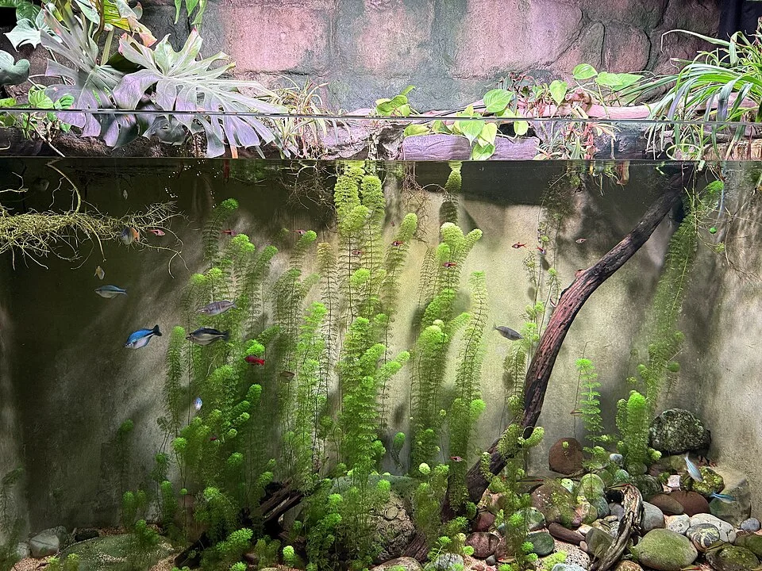

**Síntomas**: Úlceras redondas u ovaladas en la piel, borde rojizo, a veces necrosis profunda
**Causa**: Aeromonas en agua de mala calidad, estrés por temperatura baja
**Tratamiento**: Antibiótico sistémico (oxitetraciclina, amoxicilina en alimento), limpieza de la úlcera con antiséptico (cloramina-T), mejorar calidad del agua.

---

### Enfermedad Columnaris de alta temperatura (Flavobacterium columnare, cepa seca)

**Síntomas diferencial**: La forma "crónica" (temperatura < 20°C) progresa lentamente. La forma "aguda" (> 25°C) puede matar en horas.
**Diagnóstico**: Aspecto harinoso/algodonal diferente a Saprolegnia (más seca, menos filamentosa).
**Tratamiento**: Ver 11.3. La forma aguda requiere respuesta inmediata.

---

## GUÍA DE DIAGNÓSTICO RÁPIDO

### Por síntoma visual

| Síntoma | Primera sospecha | Segunda sospecha |
|---|---|---|
| Granos blancos esféricos como sal | Ich (*Ichthyophthirius* / *Cryptocaryon*) | Oodinium (más fino) |
| Polvo dorado finísimo | Velvet (*Oodinium* / *Amyloodinium*) | — |
| Mantos blancos algodonosos | Saprolegnia (hongo) | Columnaris |
| Gusanos rojos asomando por el ano | Camallanus | — |
| Ojo nublado/catarata | Diplostomum (parasitario) o bacteriana | Traumatismo físico |
| Escamas levantadas (piña) | Hidrops / Ascitis (bacteriana) | — |
| Abdomen hinchado | Hidrops, Ascitis, Hexamita | Estreñimiento, vejiga natatoria |
| Aletas pudiéndose / desflecadas | Columnaris / Aeromonas | Herida + hongos |
| Nódulos blancos en aletas (coliflor) | Linfocistis (viral) | — |
| Úlceras rojas en piel marino | Uronema / Aeromonas | Herida traumática |
| Moco excesivo + rascado marino | Brooklynella / Monogéneos | Ich marino |
| Punto blanquecino en piel marino | Ich marino o Benedenia | Brooklynella |
| Gusanos planos en corales | Polyclad Flatworms | — |
| Heces blanquecinas en peces dulce | Hexamita / parásito intestinal | Estreñimiento |
| Nado en espiral/circuloños | Bacteriano neurológico | Torsión de vejiga |
| Pérdida de color + curvatura | Síndrome del neón (Pleistophora) | Microsporidiosis |

### Por tipo de acuario

**Solo en agua dulce**: Ich dulce, Velvet dulce, Saprolegnia, Camallanus, Diplostomum, Planaria
**Solo en agua marina**: Ich marino, Velvet marino, Brooklynella, Uronema, Benedenia/Neobenedenia, Dinos parásitos
**En ambas aguas**: Columnaris, Aeromonas, Monogéneos (géneros distintos), Hexamita, Micobacteriosis, Linfocistis

---

## MEDICAMENTOS COMUNES Y USO

| Medicamento | Tipo | Para | Invertebrados |
|-------------|------|------|---------------|
| Verde malaquita | Antiséptico | Ich, velvet, hongos | TÓXICO |
| Sal de roca (NaCl) | Osmótico | Ich, nitritos, bacterias externas | TÓXICO para gambas |
| Seachem Prime | Detoxificante | Emergencias NH3/NO2 | ✅ Seguro |
| Kanamicina | Antibiótico | Bacteriana sistémica | Daña filtro bio |
| Metronidazol | Antiparasitario/antibacteriano | Hexamita, anaerobias | ⚠️ Precaución |
| Praziquantel | Antiparasitario | Tremátodos, Diplostomum | ✅ Relativamente seguro |
| Fenbendazol | Antihelmíntico | Planarias, nemátodos | Puede afectar gambas |
| Cobre quelado | Antiparasitario | Ich marino, velvet | ❌ LETAL para invertebrados |
| Levamisol | Antihelmíntico | Camallanus (gusanos rojos) | ⚠️ Precaución gambas |

---

## ACUARIO DE CUARENTENA

### Por qué es imprescindible

- Observar peces nuevos 2-4 semanas antes de introducirlos al acuario principal
- Tratar enfermedades sin afectar al acuario principal (filtro bio, invertebrados, corales)
- Detectar parásitos antes de que contaminen todo

### Setup mínimo de cuarentena

- Acuario 40-80L
- Filtro de esponja maduro (o media del filtro principal)
- Calentador
- Sin sustrato (para que los medicamentos sean efectivos)
- Escondite (tubería de PVC, maceta)
- Luz básica
- Tapa

### Protocolo cuarentena marino (método de dos recipientes)

Dividir cuarentena en dos cubos de 40L. Mover el pez de un cubo al otro cada 48h con agua limpia.
Los parásitos caen al cubo vacío → mueren sin huésped.
Tratamiento con cobre en los cubos en paralelo.