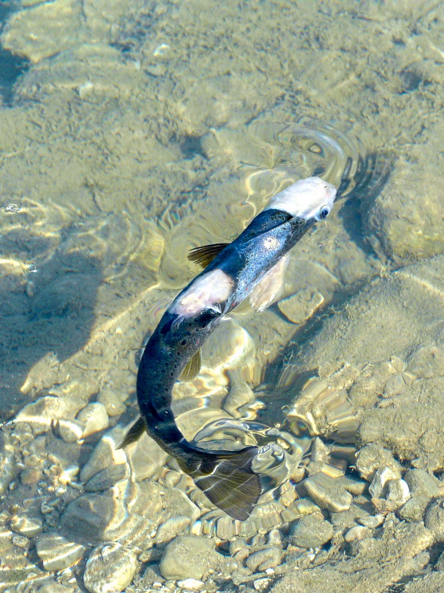

**Afecta principalmente**: Paracheirodon innesi (neón común)
**Tratamiento**: Incurable. Sacrificar peces afectados para evitar contagio.

---

## PROBLEMAS COMUNES (NO ENFERMEDADES)

### Envenenamiento por amoniaco/nitritos
**Síntomas**: Branquias rojizas, jadeo en superficie, comportamiento errático
**Solución**: Cambio de agua inmediato 30-50%, Seachem Prime como emergencia, investigar fuente del amoniaco

### Hidrops / Ascitis (escamas levantadas)
**Síntomas**: Escamas levantadas como piña, abdomen hinchado
**Causa**: Acumulación de líquido. Señal de fallo orgánico (riñones). Frecuentemente bacteriana.
**Tratamiento**: Antibiótico en comida + sal de Epsom (MgSO4) como diurético (1g/L) — pronóstico reservado

### Vejiga natatoria (Swim Bladder Disease)
**Síntomas**: Pez que nada de lado, no puede sumergirse o no puede subir
**Causas**: Sobrealimentación, estreñimiento, bacteriana, genética (en goldfish de velo)
**Solución**: Ayuno 2-3 días, dieta de guisante cocido sin piel (para estreñimiento), antibiótico si bacteriana

---

---

## ENFERMEDADES PARASITARIAS MARINAS (detalle ampliado)

### Brooklynella hostilis
**Clasificación**: Protozoo ciliado (orden Dysteriida)
**Agua**: Exclusivamente marina
**Síntomas**:
- Exceso de moco en cuerpo y branquias (aspecto viscoso)
- Rascado contra rocas e invertebrados
- Parches blancos o grises en la piel (no granos esféricos como Ich)
- Respiración muy rápida, jadeo
- Pérdida de apetito
- Piel que se desprende en placas
- Muerte en 24-48h si no se trata — MÁS RÁPIDO QUE EL ICH MARINO
**Organismos más afectados**: Especialmente peces payaso (*Amphiprion* spp.) — antes llamada "Clownfish Disease". También afecta a otras especies.
**Diagnóstico diferencial**: Más rápido que Ich, manchas irregulares (no granos esféricos), abundante moco, afecta primero las branquias.
**Ciclo**: Vive en el pez (ectoparásito). Se reproduce por división binaria directamente en el huésped.

**Tratamiento:**
- **Formalin (formaldehído 37%)**: El tratamiento más efectivo. Baño de 30 min en agua marina a 0,125-0,25 mL/L (con fuerte aireación), o tratamiento continuo a dosis muy baja (0,025 mL/L). Requiere precaución extrema con la concentración.
- **Agua dulce (freshwater dip)**: Inmersión en agua dulce misma temperatura durante 5 min — mata muchos ectoparásitos incluyendo Brooklynella. Estrés para el pez pero efectivo como ayuda.
- **Cuarentena inmediata**: No esperar. Brooklynella mata en horas.
- El cobre es **menos efectivo** contra Brooklynella que contra Ich.
**Seguridad**: Formalin es tóxico para humanos (cancerígeno) — usar con ventilación, guantes y protección ocular. NUNCA usar formalin en acuario con invertebrados o roca viva.

---