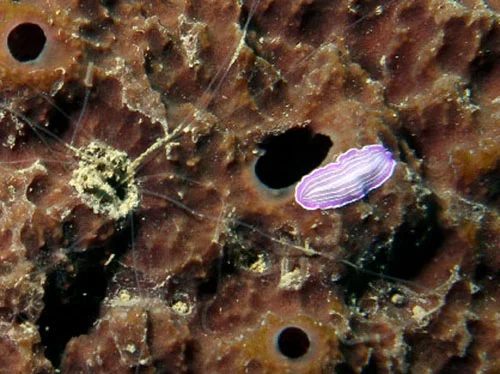

- **Mejorar calidad del agua**: Cambios de agua, limpieza del filtro
- **Sal**: 1-2 g/L en dulce
- **Verde malaquita**: Efectivo en baño
- Suele desaparecer al mejorar las condiciones del agua

---

### Schistocephalus / Diplostomum (Ojo nublado parasitario)

**Clasificación**: Tremátodo digenético (requiere aves como huésped definitivo)
**Agua**: Dulce
**Síntomas**:
- Cataratas o nubosidad en uno o ambos ojos
- Ceguera progresiva
- El pez puede tener buen apetito pero navegar mal
**Causa**: Las metacercarias del parásito se enquistan en el cristalino
**Vector**: Caracoles acuáticos son el primer huésped intermediario. Las cercarias liberadas infectan peces.
**Tratamiento**: No hay tratamiento efectivo. El ojo afectado no se recupera. Eliminar caracoles intermediarios. Sin pájaros/aves que defequen en el acuario, el ciclo no se completa.

---

### Camallanus (Gusanos Rojos Intestinales)
**Clasificación**: Nematodo intestinal (Camallanidae)
**Agua**: Dulce (raro en marino)
**Síntomas**:
- Gusanos rojos de 1-3 cm visibles saliendo del ano del pez
- Abdomen ligeramente hinchado
- Pérdida de peso, falta de apetito
- Heces blanquecinas o con mucosidad
**Causa**: Nematodo parásito del intestino
**Contagio**: Ingestión de copépodos infectados (vector), heces de peces infectados

**Tratamiento:**
- **Levamisol**: 10-12 mg/L en el acuario o alimento medicado. Paraliza los gusanos. Repetir a los 14 días para las larvas que eclosionan.
- **Fenbendazol**: En alimento medicado. Alternativa.
- **Metronidazol**: Menos efectivo para Camallanus que para otros parásitos.
- Tratar TODO el acuario, no solo los peces visiblemente afectados.

---

### Planarias (Turbellaria)
**Clasificación**: Platelmintos de vida libre (Planariidae)
**Agua**: Dulce principalmente (Planaria tigrina en dulce; en marino: Polyclad Flatworms)
**Síntomas dulce**:
- Gusanos planos blancos o marrones de 3-10 mm visibles en cristal y sustrato
- No parásitos de peces directamente, pero proliferan en exceso cuando hay mucha comida
- Pueden atacar huevos de peces
**Síntomas marino (Polyclad Flatworms)**:
- Gusanos planos de colores sobre corales (especialmente en Euphyllia)
- Los gusanos se alimentan de los tejidos del coral
- Las colonias afectadas muestran áreas blanqueadas

**Tratamiento dulce:**
- **Fenbendazol**: 1 mg/L en acuario en cuarentena o acuario sin invertebrados
- **Peces capturadores**: Gurami, Botia payaso
- **Trampa**: Plato con comida de noche → retirar con planarias al amanecer

**Tratamiento marino:**
- **Salifert Flatworm Exit**: Efectivo pero libera toxinas de los gusanos muertos → cambio de agua masivo antes del tratamiento
- **Agua dulce dip**: Para corales individuales (30-60 segundos)
- **Nudibranquios** del género *Chelidonura*: Predadores especializados de flatworms marinos

---

## ENFERMEDADES BACTERIANAS ADICIONALES

### Estreptococosis (Streptococcus iniae / agalactiae)
**Agua**: Principalmente marino y peces de estanque (tilapia, lubina)
**Síntomas**:
- Exoftalmos (ojos saltones)
- Hemorragias en aletas y piel
- Nado en círculos (neurológico)
- Abdomen hinchado
- Alta mortalidad
**Tratamiento**: Florfenicol, eritromicina, amoxicilina en alimento medicado. Difícil de tratar.
**Zoonosis**: *S. iniae* puede infectar humanos con heridas abiertas (celulitis, artritis). Usar guantes.

---

### Úlceras bacterianas en peces de estanque (Aeromonas ulcerans)
**Agua**: Dulce, especialmente estanques