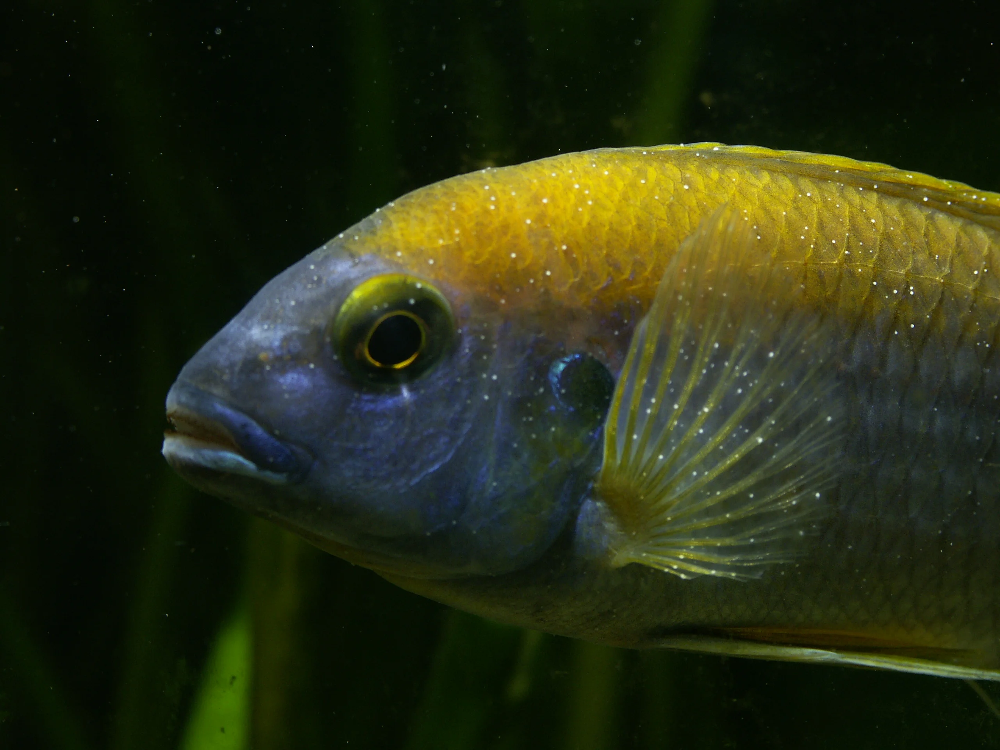
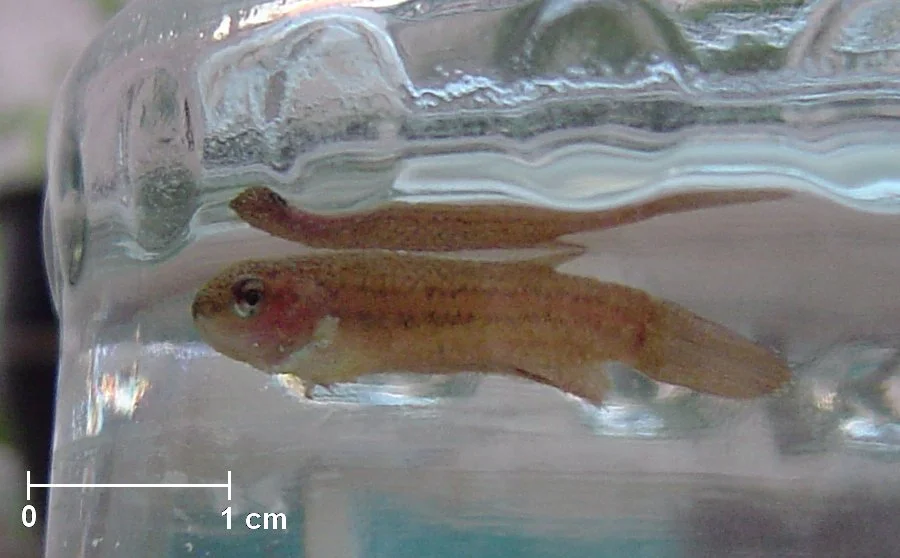
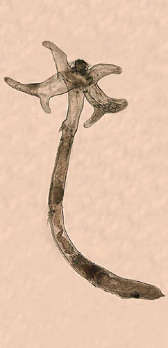

## ENFERMEDADES PARASITARIAS

### ICH / Punto Blanco (Ichthyophthirius multifiliis) — Agua dulce
**Síntomas**: Granos de sal/semolina blancos en el cuerpo y aletas, rascado contra objetos, branquias afectadas
**Causa**: Protozoo ciliado obligatorio
**Ciclo**: El parásito (trofonte) vive en el pez → cae al fondo (tomont) → se divide en centenares de tomites → nadan buscando nuevo huésped. El tratamiento solo mata los tomites nadadores — no el parásito en el pez.

**Tratamiento:**
- **Temperatura alta**: subir a 30°C acelera el ciclo (2-3x) → el ciclo termina más rápido
- **Cloruro de sodio (sal)**: 2-3 g/L en agua dulce — no para peces sensibles a sal (Corydoras, tetras de agua blanda)
- **Verde malaquita + formol** (típico medicamento ich): efectivo pero tóxico para pez en exceso
- **Formalin** (37% formaldehído diluido): muy efectivo, tóxico, usar con ventilación
- **Estrés combinado**: temperatura + sal es la opción menos tóxica

**Sin acuario de cuarentena**: El quiste (tomont) sobrevive en el acuario hasta 3 semanas sin huésped → el acuario "sin peces" durante 3-4 semanas a temperatura alta (>28°C) puede limpiar el acuario.

---

### Velvet / Terciopelo (Oodinium pilularis) — Agua dulce

**Síntomas**: Polvo dorado/grisáceo muy fino (como terciopelo), más pequeño que el ich, rascado intenso, branquias afectadas primero, respiración rápida
**Causa**: Dinoflagelado parásito
**Importancia**: Mucho más peligroso y rápido que el ich. Mata peces en días.

**Tratamiento:**
- **Oscuridad total + temperatura alta**: Oodinium fotosintético → sin luz no puede sobrevivir bien
- **Sulfato de cobre** (con medidor): el más efectivo
- **Cloruro sódico** (sal): ayuda
- **Medicamentos específicos** (eSHa EXIT, JBL Punktol Ultra)
- Cuarentena: el acuario sin peces necesita 4 semanas a oscuras

---

### Ich Marino (Cryptocaryon irritans) — Agua salada
**Similar al ich de agua dulce pero:**
- Ciclo mucho más largo (hasta 28 días)
- NO se elimina con temperatura ni sal (es un marino)
- **Tratamiento de cobre (chelated copper)** en cuarentena: Cupramine, CopperPower, Copper Power
- El acuario principal sin peces necesita **8-10 semanas** vacío para que el parásito muera sin huéspedes
- **NUNCA tratar con cobre en acuario con live rock, corales o invertebrados** — el cobre se acumula en la roca y es imposible de eliminar

**Alternativa sin cobre**:
- Hyposalinity (reducir salinidad a 1.009-1.010) durante 4-6 semanas en cuarentena
- Los peces lo toleran, el parásito no

---

### Velvet Marino (Amyloodinium ocellatum)
**El más peligroso del marino**
- Mata en 24-72h si no se trata
- Síntomas: polvo dorado, branquias afectadas, jadeo
- **Tratamiento**: Cobre quelado en cuarentena inmediato
- También sensible a pH bajo en cuarentena (pH 8.3 → reducir a 7.8-8.0 puede ayudar)

---

### Anchor Worm / Gusano ancla (Lernaea cyprinacea)

**Síntomas**: Gusanos rojizos visibles pegados al cuerpo, zona inflamada alrededor
**Causa**: Copépodo parásito externo
**Tratamiento:**
- Extracción manual con pinzas (el parásito, girando)
- Tratar la herida con antiséptico
- Dipterex (trichlorfon) / DIMILIN en el agua
- Cambios de agua frecuentes eliminan las larvas nadantes

---

### Chilodonella (Chilodonella spp.)
**Síntomas**: Piel grisácea, exceso de moco, branquias afectadas, peces boqueando en superficie
**Más peligroso en bajas temperaturas (agua fría)**
**Tratamiento**: Sal, verde malaquita, formalín, fenbendazol

---

### Tricodina (Trichodina spp.)
**Síntomas**: Rascado, exceso de moco, piel rojiza
**Tratamiento**: Sal (2-3 g/L), verde malaquita

---

## ENFERMEDADES BACTERIANAS