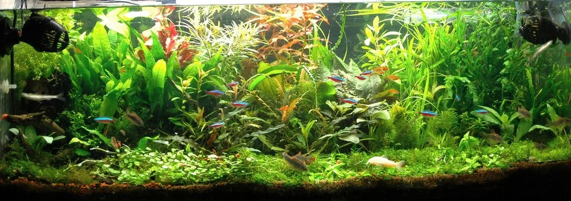

### Componentes de un equipo RO/DI

1. **Prefiltros de sedimentos**: 5 micras → 1 micra (retienen partículas sólidas)
2. **Prefiltro de carbón activo** (GAC + CTO): elimina cloro/cloraminas (protegen la membrana)
3. **Membrana de ósmosis inversa** (RO): 75-100 gpd (galones/día) para uso doméstico
4. **Cartucho DI (desionizador)**: resina de intercambio iónico → lleva el TDS a 0 ppm
5. **Depósito de almacenamiento**
6. **TDS meter**: mide pureza del agua producida

**Producción**: 75 gpd ≈ 280 L/día. El proceso genera agua "rechazada" (3-5x más que la producida) → tiene buena calidad para regar plantas o fregar.

**Mantenimiento**: Cambiar membranas y cartuchos según el uso y el TDS del agua producida.

---

## AUTOMATIZACIÓN Y CONTROL

### Controladores de acuario

**Apex (Neptune Systems)**: El más completo y popular. Controla todo el acuario vía app. Mide pH, temp, salinidad, oxigenado, controla enchufes inteligentes, dosificadoras, etc.

**GHL Profilux**: alternativa europea, muy profesional

**Raspberry Pi + ATO**: Solución DIY para aficionados a la electrónica

### ATO (Auto Top Off)

Repone automáticamente el agua que se evapora con agua dulce. Esencial en marino para mantener la salinidad estable. Usa un sensor de nivel en el sump.

**Marcas**: Tunze Osmolator, AutoAqua Smart ATO, DD H2Ocean

### Dosificadoras

Bombas peristálticas que añaden líquidos (Ca, KH, Mg, fertilizantes, bacterias) en cantidades precisas y programadas.
**Marcas**: GHL, Kamoer, Jebao, Bubble Magus

---

## INSTRUMENTOS DE MEDICIÓN