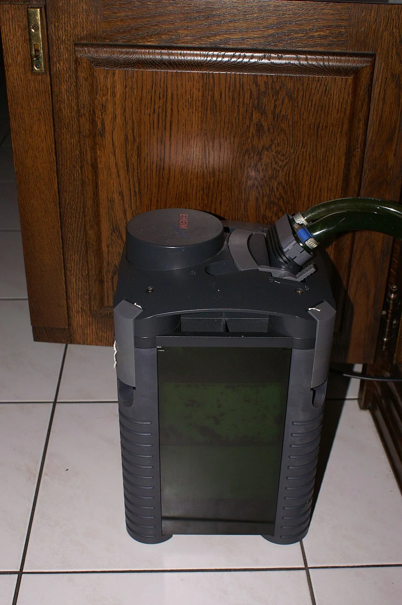

## FILTROS

### Tipos de filtración

| Tipo | Mecanismo | Lo que elimina |
|------|-----------|----------------|
| Mecánica | Físico (esponjas, algodón) | Partículas sólidas suspendidas |
| Biológica | Bacterias nitrificantes | NH3, NO2 |
| Química | Carbón, resinas, zeolita | Medicamentos, taninos, fosfatos, etc. |

Los tres tipos deben combinarse en un filtro eficiente. La biológica es la más importante para la salud del acuario.

---

### Filtros de interior (filtros sumergibles)

**Filtro de esponja (airstone/esponja)**
- Funcionamiento: Bomba de aire crea corriente a través de esponja → mecánico + biológico
- Para: acuarios de gambas, cría, quarantine
- Ventajas: No aspira crías ni gambas, barato, fácil de limpiar
- Desventajas: Poca filtración mecánica fina

**Filtros tipo caja sumergible (HOB in-tank)**
- Tipos: Tetra Brillant, JBL CristalProfi i
- Para: Acuarios pequeños-medianos
- Ventajas: Fácil instalación, económico
- Desventajas: Ocupan espacio en el acuario

**HOB — Hang-On-Back (filtro colgante exterior)**
- Tipos: AquaClear, Fluval C, Seachem Tidal
- Para: Acuarios pequeños-medianos
- Ventajas: No ocupa espacio interior, muy fácil de mantener y modificar
- Desventajas: El nivel de agua debe ser correcto, ruidoso en algunos modelos

---

### Filtros externos (canister)

El estándar para acuarios medianos y grandes.

**Cómo funciona:**
Agua sale del acuario por tubo de aspiración → entra al canister por abajo → sube a través de los medios filtrantes → sale bombeada de vuelta al acuario.

**Ventajas:**
- Gran capacidad de medios filtrantes
- Alta eficiencia biológica
- Silencioso
- No ocupa espacio en el acuario

**Modelos recomendados:**

| Marca/Modelo | Litros adecuados | Característica |
|--------------|-----------------|----------------|
| Eheim Classic 350 | hasta 350L | El más fiable del mercado, dura décadas |
| Eheim Experience/Pro | 100-600L | Cebado automático, muy cómodo |
| JBL CristalProfi e | 80-700L | Buen relación precio/calidad |
| Fluval 07 series | 100-500L | Fácil mantenimiento |
| Oase BioMaster | 100-600L | Prefiltro extraíble muy conveniente |
| AQUAEL Maxikani | 250-500L | Económico, buen rendimiento |

**Tasa de filtración recomendada**: 5-10x el volumen del acuario/hora
(Ejemplo: acuario de 200L → filtro de 1000-2000 L/h)

---

### Medios filtrantes

**Mecánicos (en orden de grueso a fino, de entrada a salida):**
- Esponja gruesa (azul) → retiene partículas grandes
- Esponja fina (blanca) → retiene partículas pequeñas
- Algodón de filtro / filter floss → retiene partículas muy finas

**Biológicos:**
- **Cerámica porosa** (Eheim Substrat Pro, Seachem Matrix): alta superficie para bacterias
- **Biobolas**: superficie rugosa, buena aireación, buen sustrato biológico
- **K1 Media / Moving Bed**: los más modernos, en constante movimiento → nunca se taponan
- **Lava rock / Roca volcánica**: económico y efectivo, alta porosidad

**Químicos:**
- **Carbón activo**: elimina medicamentos, taninos, contaminantes. NO usar de forma permanente → regenerarse
- **Zeolita**: captura amoniaco. Solo en ciclo inicial o emergencias. Sin sal
- **Resina de fosfatos (GFO)**: elimina fosfatos. En reactor o en bolsa
- **Resina de nitratos**: poco común, cara
- **Resinas de intercambio iónico**: para agua de osmosis

---

### Skimmer de proteínas (solo marino)

**¿Qué es?**
Produce burbujas de aire muy finas que arrastran materia orgánica disuelta y la concentran en una copa colectora. Elimina proteínas, grasas, etc. antes de que se descompongan → evita subida de NO3 y PO4.

**Tipos:**
- **Skimmer de cuello de aguja (Needle Wheel)**: el más eficiente, las burbujas más finas
- **Skimmer de cámara de contraflujo**: más sencillo, menos eficiente

**Tamaño**: Siempre comprar el que es para el doble del volumen del acuario → sobredimensionado = trabaja más relajado y hace más efectiva la extracción.

**Marcas**: Bubble Magus, Aqua Medic, Vertex, Nyos, Deltec (los mejores)

---

### Refugio (Refugium)

Compartimento separado del acuario principal (dentro del sump) donde se cultivan macroalgas (Chaetomorpha, Caulerpa). Las algas absorben NO3 y PO4 y se cosechan periódicamente (sacando la alga). También es hábitat de copépodos para alimentar peces difíciles.

---

### Sump

Depósito extra debajo del acuario principal conectado por reboradero (overflow). Contiene el equipamiento (calentador, skimmer, refugio). Aumenta el volumen total del sistema → mayor estabilidad química.

---

## ILUMINACIÓN