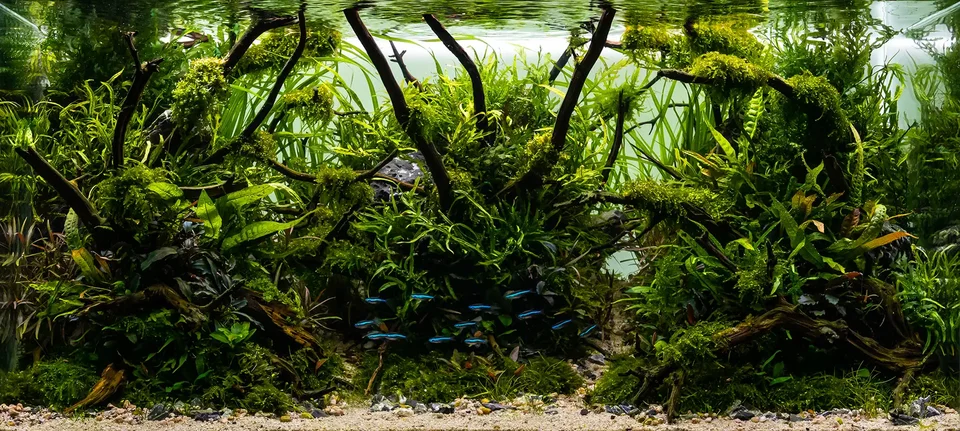

### Tecnologías

**Fluorescentes T5 y T8 (tecnología clásica)**
- T5 de alta potencia: excelente para plantado y marino
- Espectro lineal uniforme: buena cobertura en acuarios largos
- Consume más que LED pero tiene excelente calidad espectral para corales
- Se degradan con el tiempo → cambiar tubos cada 9-12 meses

**LED**
- Bajo consumo, larga vida (50000h)
- Control de intensidad y espectro (dimmer, programación)
- La tecnología domina el mercado actual
- Calidad varía enormemente → comprar marcas de acuariofilia específicas

**Metal Halide (halogenuros metálicos)**
- Tecnología antigua pero efectiva para SPS y anémonas
- Mucho calor → necesita chiller
- Sustituido mayoritariamente por LED de calidad

---

### Ciclo de luz (fotoperiodo)

**Agua dulce tropical:**
- 8-10 horas de luz al día
- Simular salida y puesta del sol (rampa 30-60 min)

**Acuario plantado:**
- 8-10 horas de iluminación intensa
- Sin más para evitar exceso de algas

**Marino arrecife:**
- Ciclo complejo: azul/blanco/UV
- Salida del sol: rampa de azul 2h antes del blanco
- 8-10h de máxima intensidad
- Puesta del sol: rampa inversa
- Noche: luz lunar (azul muy tenue)

---

### Índice PAR — Medición de la luz fotosintética

**Instrumento**: PAR meter (sonda cuántica) — Apogee, Seneye, Licor
**Valores orientativos:**

| Zona acuario | PAR para plantas | PAR para corales blandos | PAR para SPS |
|-------------|-----------------|------------------------|-------------|
| Superficie | 100-200 | 100-300 | 300-600 |
| Medio | 50-100 | 75-200 | 200-400 |
| Fondo | 20-50 | 30-100 | 100-250 |

---

## CALEFACCIÓN Y REFRIGERACIÓN