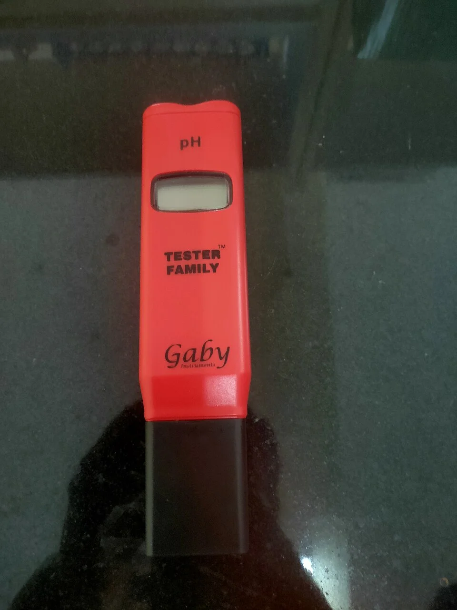

### Tests de agua

| Test | Frecuencia | Método recomendado |
|------|-----------|-------------------|
| pH | Semanal | Colorimétrico (API) o pHmetro digital |
| NH3/NH4 | En maduración y emergencias | Colorimétrico (API, Salifert) |
| NO2 | En maduración | Colorimétrico |
| NO3 | Mensual | Colorimétrico o gota (Salifert) |
| KH | Mensual (marino: semanal) | Titulación (Salifert, Hanna) |
| GH | Mensual | Titulación |
| Ca | Marino: semanal | Titulación (Salifert, Hanna) |
| Mg | Marino: mensual | Titulación |
| PO4 | Marino: semanal, dulce: mensual | Colorimétrico (Hanna Colorimeter es el más preciso) |
| Salinidad | Marino: diario | Refractómetro |
| Temperatura | Diario | Termómetro digital |

### Kits de tests recomendados

**Agua dulce básico**: API Freshwater Master Test Kit (NH3, NO2, NO3, pH)
**Marino completo**: Salifert (test individual para cada parámetro, muy preciso) o Red Sea Reef Foundation Pro Test Kit

### Calibración de instrumentos

- **Refractómetros**: calibrar con RODI (agua pura debería dar 1.000)
- **pH metros**: calibrar con soluciones buffer 4.0, 7.0, 10.0
- **Sondas de O2**: calibrar en agua saturada a temperatura conocida