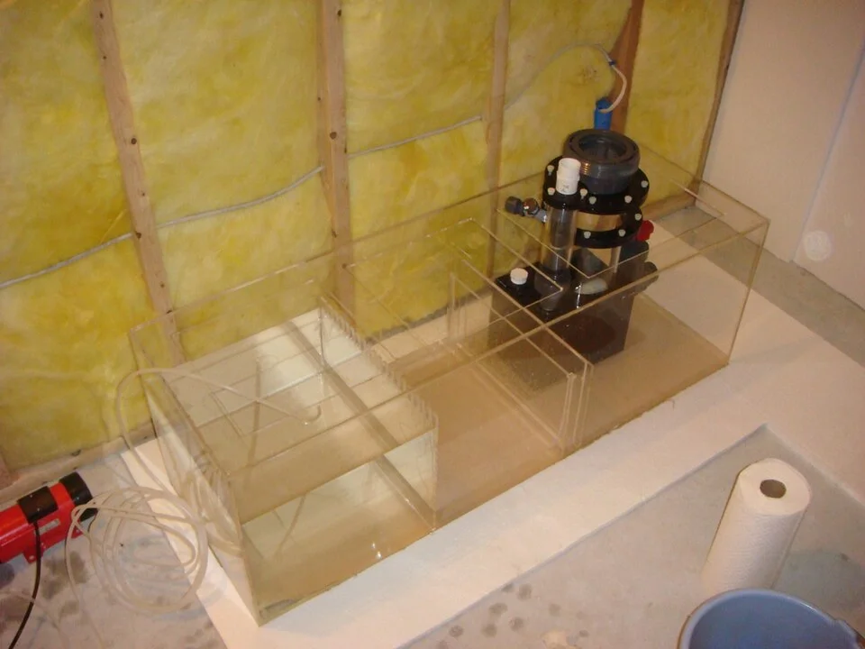

Revisión semanal obligatoria en reef con corales:
- **Ca < 350 ppm**: Dosificar Ca o cambio de agua con agua rica en Ca
- **KH < 7 dKH**: Dosificar bicarbonato potásico/sódico o Parte B del sistema Balling
- **Mg < 1200 ppm**: Dosificar sulfato de magnesio (Epsom + MgCl2)

**Nota**: CA y KH deben estar en equilibrio. Si se sube mucho Ca sin subir KH o viceversa → precipitación de CaCO3 (agua lechosa).

### Revisión de la roca viva / Corales

**Mensual:**
- Buscar Aiptasia nueva → tratar inmediatamente antes que prolifere
- Buscar cangrejos no deseados (cangrejo de arrecife — emerotherion) — pueden comer corales
- Revisar la base de los corales → necrosis basal es señal de estrés
- Fotografiar los corales → comparar con foto anterior para ver crecimiento o retracción

### Curación de roca nueva

Al añadir roca viva nueva al acuario:
1. Inspeccionar por hitchhikers indeseados (mantis, cangrejos agresivos, Aiptasia)
2. Curar en cubo aparte con calefactor, circulación y luz durante 2-4 semanas
3. Cambiar el agua del cubo semanalmente
4. Solo añadir al acuario principal cuando los parámetros del cubo se estabilicen

---

## RESOLUCIÓN DE PROBLEMAS COMUNES

### El agua está turbia

**Blanca / lechosa** → Bloom bacteriano (normal en acuarios nuevos o tras perturbación del sustrato) → Esperar, cambiar algo de agua. Si persiste → verificar filtración
**Verde** → Bloom de algas unicelulares → Reducir luz, cambio de agua, revisar nutrientes
**Marrón/amarilla** → Taninos (madera nueva) → Normal y no dañino. Carbón activo lo elimina.
**Gris** → Filtro sucio o mucho detritus → Limpiar filtro, aspirar el fondo

### El agua huele mal

**Huevo podrido (H2S)** → Zona anóxica en el sustrato o filtro sucio → Limpiar filtro, retocar sustrato
**Putrefacción** → Pez o planta muerta sin localizar → Buscar y retirar
**Agua de pantano** → Sobrealimentación + mala filtración → Cambio de agua + reducir alimentación

### Hay muchas algas

Ver sección especializada de algas (integrada en Sección 2 y 3). Causas más comunes:
- Exceso de luz (demasiado tiempo o potencia)
- Exceso de nutrientes (NO3 y PO4)
- Desequilibrio entre nutrientes y plantas
- Acuario joven en desequilibrio

**El método BBA (Black Brush Algae / Alga negra):**
- Causa: Fluctuaciones de CO2 (en plantados)
- Solución: Estabilizar CO2, tratar con Easy Carbo directamente sobre el alga (fuera del agua con pipeta), introducir Caridina japonica (Amano)

### Caída de peces en acuario maduro

Sin causa obvia aparente: