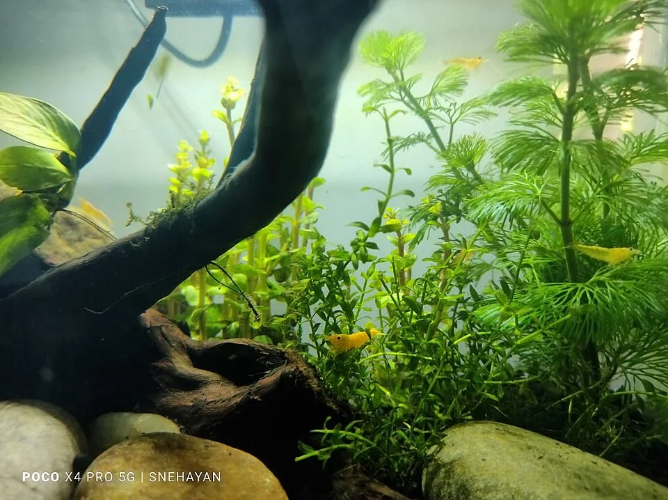

## RUTINA SEMANAL

### Cambio de agua parcial

**El mantenimiento más importante.**

**¿Cuánto cambiar?**
- Agua dulce estándar: 20-30% semanal
- Agua dulce con plantado intensivo (EI): 50% semanal
- Marino FOWLR: 10-15% semanal
- Arrecife: 5-10% semanal (o dosificación + cambios más pequeños)
- Acuario de gambas: 5-10% semanal con agua de parámetros exactos
- Discus: 30-50% cada 2-3 días en algunos protocolos

**¿Por qué cambiar agua?**
- Eliminar nitratos acumulados
- Reponer minerales (Ca, Mg, KH, trace elements)
- Limpiar toxinas que los tests no miden
- "Reset" de la química del agua

**Cómo hacer el cambio:**
1. Preparar agua nueva con el acondicionador (eliminar cloro/cloraminas) o usar RODI remineralizada
2. Igualar temperatura del agua nueva con la del acuario (±1°C)
3. Sifón del fondo → aspirar residuos y heces del sustrato mientras se vacía
4. Añadir agua nueva lentamente (para no estresar peces con cambio brusco de parámetros)

**En marino:**
- El agua nueva debe tener la misma salinidad (mezclar sal y dejar madurar 24h o usar sistema de mezcla)
- Agua de mar sintética (Instant Ocean, Red Sea Salt, Tropic Marin) — distintas calidades

---

### Limpieza del cristal

- **Algas verdes puntiformes / GSA**: Rascar con rasqueta o magnético
- **Algas verdes de cristal**: Rascar semanalmente antes que se "calcifiquen"
- En marino: Algas coralinas en el cristal frontal → rasqueta metálica o de titanio
- Cristales laterales y trasero: Opcional — muchos acuaristas los dejan con algo de alga (alimento natural)

---

### Poda de plantas (si plantado)
- Cortar plantas que hayan crecido por encima del agua o estén tapando a otras
- Eliminar hojas muertas o dañadas

---