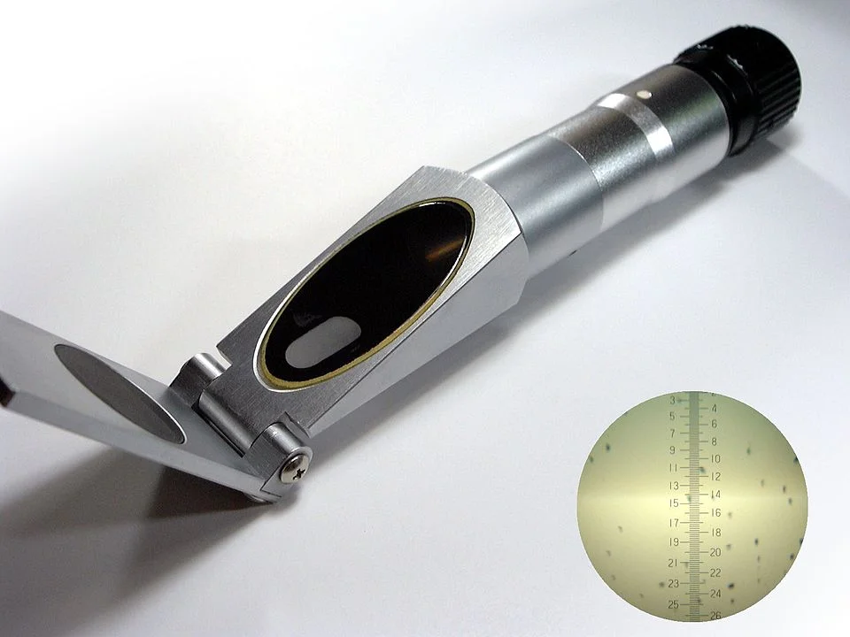

### Valores

| Nivel | Situación |
|-------|-----------|
| >7 ppm | Excelente |
| 5 – 7 ppm | Aceptable |
| 3 – 5 ppm | Estrés para muchas especies |
| <3 ppm | Peligroso — peces en superficie buscando aire |

### Qué reduce el O2
- Temperatura alta (agua caliente disuelve menos O2)
- Exceso de CO2 inyectado
- Poca superficie de intercambio (acuario alto y estrecho)
- Mucha materia orgánica en descomposición
- Sin aireación nocturna en plantados

### Cómo aumentar el O2
- Aireación (piedra difusora, bomba de aire)
- Movimiento de superficie (ajustar salida del filtro)
- Reducir temperatura
- En plantados: apagar CO2 por la noche o programar aireación nocturna

---

## Salinidad y Densidad (agua marina y salobre)

### ¿Qué es?
La salinidad mide la concentración de sales disueltas. En acuarios marinos, se mide por:
- **Densidad** (refractómetro): agua dulce = 1.000, océano ≈ 1.025
- **ppt** (partes por mil): océano ≈ 35 ppt
- **Salinidad práctica (PSU/‰)**: escala estándar

### Valores

| Tipo | Densidad | Salinidad |
|------|----------|-----------|
| Agua dulce | 1.000 | 0 ppt |
| Salobre leve | 1.003 – 1.008 | 5 – 12 ppt |
| Salobre moderado | 1.008 – 1.015 | 12 – 22 ppt |
| Marino FOWLR | 1.020 – 1.025 | 27 – 35 ppt |
| Arrecife de coral | 1.024 – 1.026 | 33 – 36 ppt |

### Evaporación y salinidad
El agua se evapora pero la sal no → la salinidad **sube** con la evaporación. Reponer siempre con **agua dulce** (no salada). Usar un ATO (Automatic Top Off) en acuarios marinos avanzados.

### Instrumentos de medición
- **Refractómetro de doble escala** (ATC): el más recomendado, económico y preciso
- **Densímetro de aguja flotante**: barato pero poco preciso
- **Refractómetro digital**: muy preciso, caro
- **Salinómetro electrónico**: profesional

---

## Calcio y Magnesio (marinos)

### Valores objetivo en arrecife

| Parámetro | Valor óptimo |
|-----------|-------------|
| Calcio (Ca) | 380 – 450 ppm |
| Magnesio (Mg) | 1200 – 1400 ppm |
| Alcalinidad (KH) | 8 – 12 °dKH |

### Métodos de aporte (dosificación)

**Sistema Balling (2 partes):**
- Parte A: Cloruro cálcico (Ca + Cl)
- Parte B: Bicarbonato sódico (KH)
- Se dosifica en partes iguales diarias

**Sistema Balling completo (3 partes):**
- Parte A: Ca
- Parte B: KH/Alk
- Parte C: Mg
- Más preciso, permite ajuste independiente

**Reactor de calcio (kalkwasser):**
- Disuelve medios de aragonito/caliza con CO2
- Produce agua rica en Ca y KH
- Coste de operación bajo, requiere ajuste