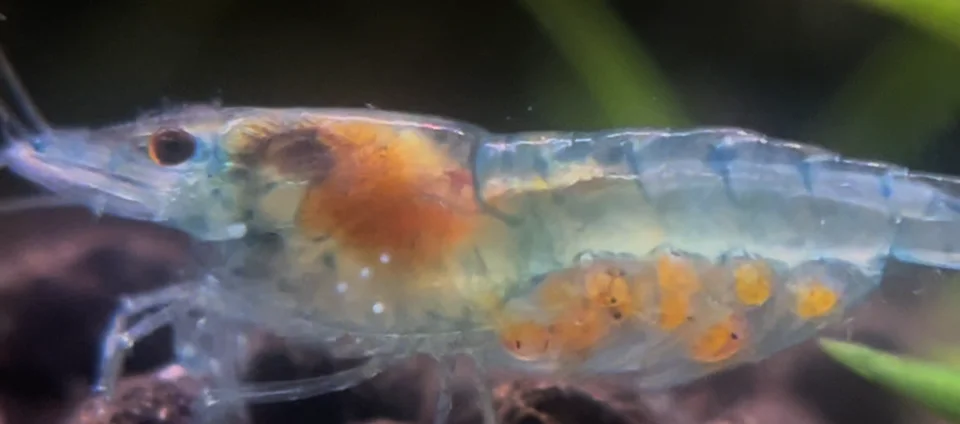

6. **Retirar la hembra** → el macho la atacará para defender el nido
7. El macho cuida solo el nido 2-3 días hasta eclosión
8. Al nadar libremente las crías, retirar también al macho

**Setup de cría:**
- Acuario bajo (25-30 cm de altura máxima — crías aún no pueden nadar largas distancias verticales)
- Hoja de helecho/planta flotante para el nido
- Nivel de agua bajo (20 cm) — las crías suben a la superficie para respirar
- Sin filtro (aspira crías) — cambios de agua parciales pequeños

---

## REPRODUCCIÓN DE GAMBAS

### Neocaridina davidi (Cherry Shrimp)

**Proceso:**
1. Cuando la hembra está lista, hace una "danza de muda" (muda y libera feromonas)
2. Los machos enloquecen y nadan frenéticamente buscando a la hembra
3. Fertilización inmediatamente tras la muda
4. La hembra lleva los huevos bajo el abdomen 3-4 semanas
5. Las crías nacen como réplicas diminutas del adulto
6. Son autónomas desde el primer día

**Señal de reproducción inminente:**
La "silla de montar" (mancha sobre el dorso de la hembra) se vuelve visible → son los ovarios que contienen los óvulos antes de la fertilización.

**Crías:**
- No necesitan alimento especial → comen biofilm natural del acuario
- Musgo Java como refugio y fuente de biofilm
- Sin peces que se las coman

### Caridina CBS/CRS

Igual proceso que Neocaridina pero con camadas más pequeñas (15-30 crías vs 20-50 en Neocaridina). La hembra lleva los huevos 4-5 semanas.

---

## REPRODUCCIÓN DE CARACOLES

### Nerite
- Solo en agua salobre → no invasivos en dulce
- Los "puntos blancos" que aparecen en el cristal y decoración son las cápsulas de huevos (no eclosionan en agua dulce)
- Para criar nerites verdaderamente se necesita transferir los huevos a agua salobre (10-15 ppt) + agua salada al 100% para las larvas veliger