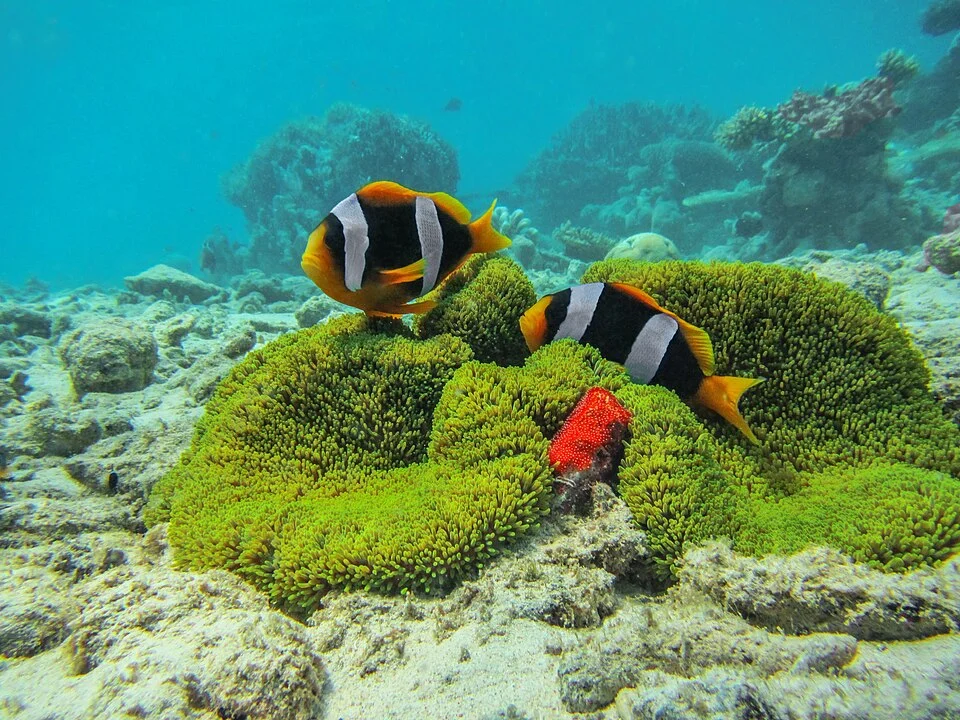

### Caracoles manzana (Pomacea)

- Sexado: El macho tiene el pene visible bajo el opérculo (tubo grueso blanco)
- La hembra pone masas de huevos rosas FUERA del agua (en la tapa o el borde)
- Eclosionan en 2-4 semanas
- Las crías caen al agua al nacer

### Ramshorn / Physa
- Hermafroditas simultáneos — dos individuos se fecundan mutuamente
- Ponen masas gelatinosas de huevos en el cristal y decoración
- Se reproducen explosivamente si hay exceso de comida

---

## CRÍA DE ALEVINES Y CRÍAS

### Alimentación por etapa

| Edad | Alimento |
|------|----------|
| 0-3 días | Saco vitelino (no comen) |
| 3-7 días | Infusoria, polvo de fry, yema de huevo cocido |
| 1-2 semanas | Artemia nauplia, microgusanos, polvo de fry |
| 2-4 semanas | Artemia adulta pequeña, cíclopes, polvo fino |
| 1 mes+ | Artemia adulta, congelados finos |

### Cultivo de infusoria

Infusoria = cultura de microorganismos (paramecium, rotiferos, vorticelas)
**Cómo cultivar:**
1. Recipiente con agua del acuario
2. Añadir lechuga hervida o piel de plátano
3. Mantener a temperatura ambiente en luz indirecta
4. En 3-5 días la "sopa" se enturbia → llena de infusoria
5. Añadir directamente al acuario de crías

### Frecuencia de alimentación en crías
4-6 veces al día. El metabolismo de los alevines es muy rápido y necesitan comida constantemente en sus primeras semanas.

### Control de calidad del agua en acuario de cría
- Los alevines son muy sensibles al amoniaco
- Cambios de agua pequeños diarios (10%) con agua preparada de igual temperatura y parámetros
- Sifón muy cuidadoso o no sifón en las primeras semanas (aspirar crías)