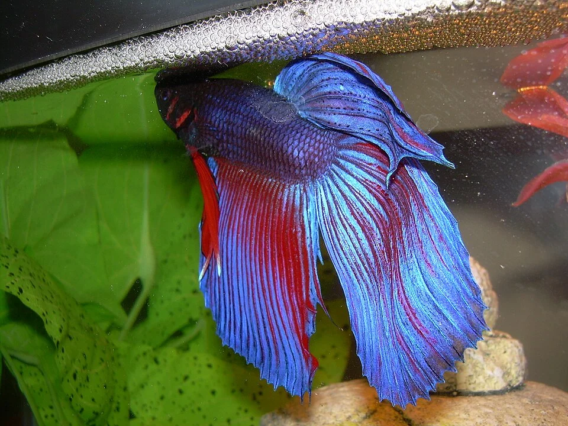

## REPRODUCCIÓN DE OVÍPAROS

### Tetras y Cipriniformes (huevos dispersos)

**Proceso:**
1. Los machos persiguen a las hembras
2. La hembra deposita huevos entre plantas, el macho los fertiliza al paso
3. Los padres NO cuidan los huevos ni las crías — los comen si pueden
4. Los huevos eclosionan en 24-48h
5. Las larvas están inmóviles 2-3 días absorbiendo el saco vitelino
6. Empiezan a nadar y comer libremente

**Para reproducir tetras en casa:**
- Acuario de cría pequeño (10-20L) sin sustrato, muy poca luz
- Sustrato artificial (mop de lana, malla de nylon) o plantas densas donde caigan los huevos
- Agua blanda y ácida (osmotizada con pH 6.0-6.5) — estimula la reproducción
- Introducir una hembra gordita + 2 machos
- Retirar los padres inmediatamente después de la puesta
- Oscuridad total — los huevos de tetra son sensibles a la luz

---

### Corydoras

**Proceso:**
1. La hembra recoge el esperma del macho con la boca
2. Lleva el esperma en las branquias hacia las aletas pélvicas en forma de "bolsa"
3. Deposita unos pocos huevos pegajosos en el cristal, plantas o decoración
4. Repite el proceso muchas veces durante 1-2 horas
5. Los huevos eclosionan en 3-5 días

**Estimulación:**
- Cambio de agua parcial con agua más fría (simula lluvia estacional)
- Temperatura bajada 2-4°C
- Alimentación abundante los días previos

**Cría de larvas:**
- Retirar los huevos del acuario principal (escamas/plantas con huevos incluidos)
- Incubar en recipiente con aireación suave y pocas gotas de azul de metileno (anti-hongos)
- Las larvas comen infusoria, nauplia de artemia y polvo de fry

---

### Ciclidos (guardianes y cuidadores)

**Los ciclidos son padres excepcionales.**

**Ciclidos de sustrato (Apistogramma, Discus, Scalara)**

**Proceso:**
1. La pareja forma un vínculo (courtship)
2. Limpian una superficie (roca, hoja, cerámica): el sustrato de puesta
3. La hembra pone 50-500 huevos
4. Ambos (o solo la hembra) los abanicarán con las aletas, retirarán huevos no fecundados/hongos
5. Al eclosionar, los padres mueven las larvas a "hoyos" que han excavado
6. En 5-10 días las crías nadan libres, los padres siguen protegiéndolas
7. Duración del cuidado: 2-6 semanas según especie

**Discus — caso especial:**
Las crías comen el moco (slime coat) de los padres durante las primeras 2 semanas. Es fundamental no separar la familia.

**Ciclidos africanos incubadores bucales**

**Proceso:**
1. El macho excava un nido en la arena
2. Corteja a la hembra con danzas
3. La hembra recoge los huevos en la boca
4. Continúa recogiendo huevos que el macho fertiliza (los puntos en la aleta anal del macho imitan huevos)
5. La hembra incuba 21-28 días SIN COMER
6. Al liberar las crías, las hembras las readmite en la boca ante amenazas

**Cuidado en cría:**
- La hembra incubante puede ser hostigada — aislarla
- Extraer las crías a las 2-3 semanas en el acuario de cría (retirar hembra, crías en la boca salen)

---

### Betta splendens

**Proceso:**
1. El macho construye un **nido de burbujas** en la superficie (bajo hoja flotante)
2. Corteja a la hembra (abrir aletas, colores intensos, persecución)
3. El macho abraza a la hembra (amplexo)
4. Los huevos flotan hacia arriba, el macho los recoge con la boca y los lleva al nido
5. Repetición del amplexo hasta 300-500 huevos