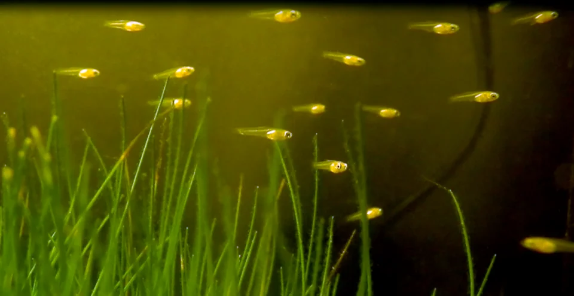

## REPRODUCCIÓN DE VIVÍPAROS

### Peces más fáciles de reproducir

**Guppy, Platy, Molly, Espada (Familia Poeciliidae)**

**Proceso:**
1. El macho introduce el esperma con el gonopodio (aleta anal modificada)
2. La hembra almacena esperma — puede tener varias camadas sin nuevo macho
3. Preñez dura 4-6 semanas (según temperatura)
4. La hembra parirá 10-100 crías según especie y tamaño
5. Las crías nadan desde el primer momento

**Señales de parto inminente:**
- Abdomen muy hinchado y cuadrado (la "mancha de gravedad" visible en trasluz)
- La hembra se aleja de los demás y busca rincones tranquilos
- Pérdida de coloración

**Supervivencia de las crías:**
- Los adultos comen a las crías si hay oportunidad
- Plantas densas, musgo, Limnobium en la superficie como refugio natural
- Separar a la hembra embarazada a un acuario de cría o usar "trampa de maternidad" (cage flotante)
- Alimentar crías con polvo de fry (First Bites, Sera Micron), artemia nauplia, infusoria

---